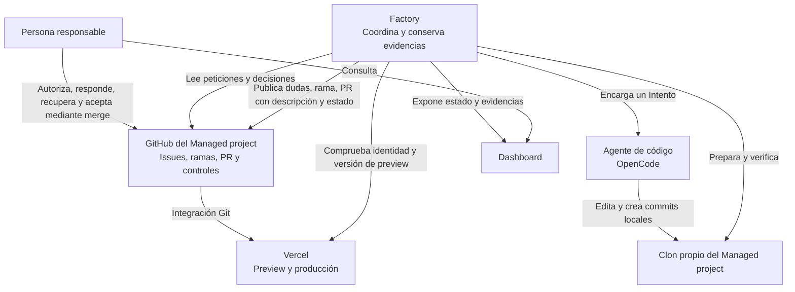
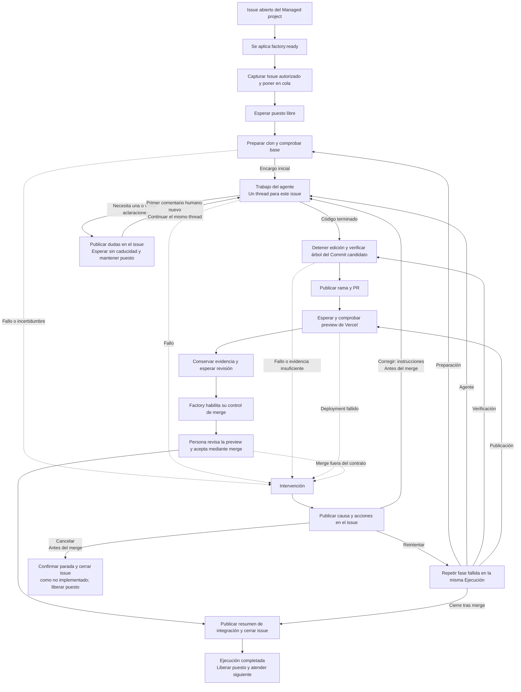
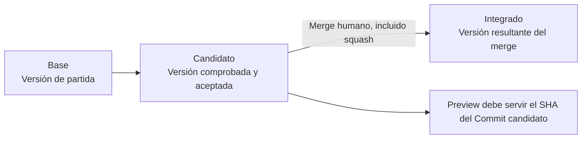

# 1. Mapa de la fábrica

[Índice](README.md) · [Siguiente: del issue al agente](02-issue-y-trabajo.md)

## Quién hace qué

La persona decide el objetivo y si el resultado es aceptable. El agente propone código. La Factory controla el recorrido y verifica las pruebas. GitHub conserva la conversación y la integración. Vercel construye y sirve las versiones mediante su integración con GitHub.

El dashboard permite entender lo que ocurre, pero no autoriza peticiones, responde preguntas del agente ni acepta resultados.

Las dudas del agente se responden en el issue. Cualquier persona puede aportar esa información sin permisos de escritura; la aceptación mediante merge conserva sus controles de permisos.

## Los dos repositorios

| Repositorio                                                              | Contenido y propósito                                                                            |
| ------------------------------------------------------------------------ | ------------------------------------------------------------------------------------------------ |
| Factory: `rubenbp/app-foundry`                                           | Código y documentación de la fábrica. Sus issues describen cambios en la propia Factory.         |
| Managed project configurado: por ejemplo, `rubenbp/appfoundry-site-demo` | Producto desarrollado. Aquí se crean los issues que consume la fábrica y las PR con sus cambios. |

Un issue del repositorio de la Factory no se convierte en trabajo para Rebobina. La admisión consulta el repositorio del Managed project configurado. Las PR no son una entrada alternativa de peticiones.

## Vocabulario para seguir el recorrido

| Término                      | Significado práctico                                                                                                                                                        |
| ---------------------------- | --------------------------------------------------------------------------------------------------------------------------------------------------------------------------- |
| **Issue autorizado**         | Issue admitido al observar `factory:ready`, con su contenido capturado como encargo inicial. Permite empezar, pero no acepta el resultado.                                  |
| **Ejecución**                | Recorrido completo para atender esa petición, incluidas esperas, integración y cierre del issue.                                                                            |
| **Intento**                  | Trabajo encargado al agente dentro de la Ejecución. Puede incluir varias rondas de aclaraciones en el mismo thread; no hay reintento automático.                            |
| **Aceptación del resultado** | Decisión humana sobre un Commit candidato concreto, expresada mediante el merge de su PR tras revisar la preview.                                                           |
| **Base**                     | Versión de partida del producto, identificada por su SHA.                                                                                                                   |
| **Commit candidato**         | `HEAD` de la rama de trabajo que dejó el agente. La Factory verifica todos los cambios acumulados desde la base antes de presentarlo para aceptación.                       |
| **SHA**                      | Identificador completo de una versión de Git. Permite saber exactamente qué se comprobó y aceptó.                                                                           |
| **PR**                       | Propuesta de integración en GitHub, con los cambios y la conversación de revisión.                                                                                          |
| **Preview**                  | Versión de prueba desplegada para revisar el Commit candidato antes de integrarlo.                                                                                          |
| **Commit integrado**         | Versión resultante del merge. Su SHA puede diferir del Commit candidato, por ejemplo con squash.                                                                            |
| **Intervención**             | Situación que requiere inspección o decisión porque falta una garantía o hay un fallo. Conserva el puesto de trabajo mientras no se resuelva o detenga de forma confirmada. |

## Recorrido completo

La intervención tiene salida desde el mismo issue: `Reintentar` repite la fase fallida y `Corregir: instrucciones` encarga otro Intento en la misma conversación, rama y PR. `Cancelar` confirma la parada y cierra como no implementado. Basta un comentario humano, sin comprobar permisos para estas órdenes. Después del merge solo se reintentan el resumen y el cierre pendientes.

Este es el camino favorable. [Las variantes](05-variantes-e-intervencion.md) explican cuándo se espera, se vuelve a comprobar o se exige intervención.

## Tres versiones que no deben confundirse

La preview debe servir el Commit candidato que se presenta a revisión. La persona responsable comprueba allí el resultado antes de aceptarlo; la Factory termina con la integración y el cierre.
