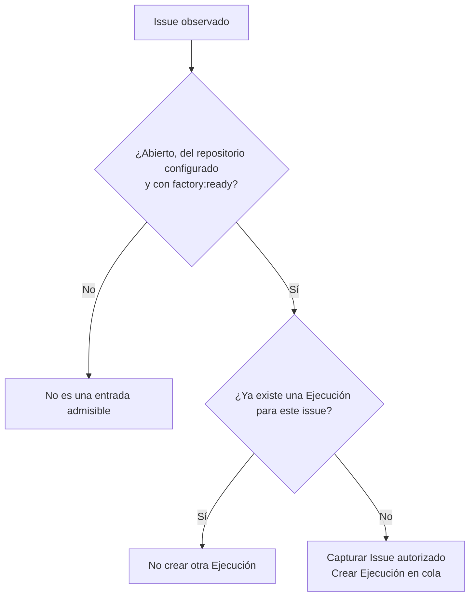
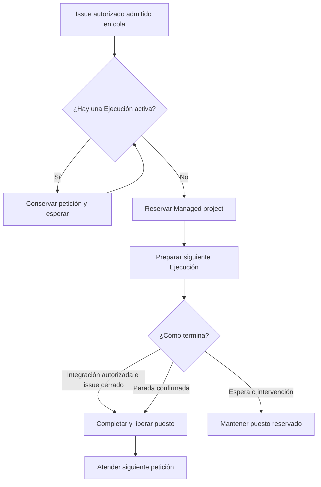
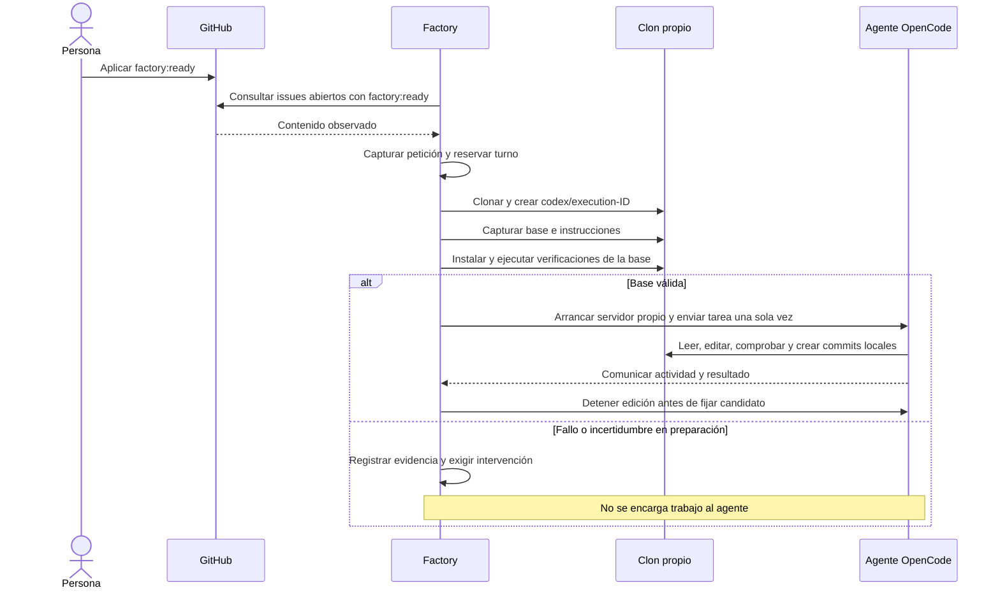

# 2. Del issue al trabajo del agente

[Índice](README.md) · [Anterior](01-mapa.md) · [Siguiente: verificación y aceptación](03-verificacion-y-aceptacion.md)

## Estados visibles en GitHub

Las etiquetas reflejan los estados de la Ejecución; no añaden fases ni pasos de aceptación. La Factory crea las definiciones que falten en el repositorio del Managed project y sustituye únicamente sus etiquetas de estado conocidas. Conserva las etiquetas ajenas, incluidas otras `factory:*` que no pertenezcan a este contrato.

| Etiqueta                 | Significado                                                                                   |
| ------------------------ | --------------------------------------------------------------------------------------------- |
| `factory:ready`          | Autorizado por una persona, todavía sin admitir.                                              |
| `factory:queued`         | Encargo capturado, esperando el único puesto.                                                 |
| `factory:in-progress`    | Preparación, desarrollo, verificaciones, espera automática de preview o cierre tras el merge. |
| `factory:needs-human`    | Pregunta del agente o incidencia operativa.                                                   |
| `factory:pending-review` | Preview verificada y evidencia disponibles; falta revisión y aceptación mediante merge.       |
| `factory:completed`      | Integración, resumen y cierre confirmados.                                                    |
| `factory:stopped`        | Parada confirmada.                                                                            |

Al admitir el encargo, se sustituye `factory:ready` por `factory:queued`. Cuando adquiere el puesto pasa a `factory:in-progress`. La cola ya existe en código y queda persistida aunque otro issue esté trabajando. Quitar una etiqueta después de admitir no cancela ni vuelve a admitir el encargo; para cancelarlo, usa `Cancelar`.

Las actualizaciones conservan intención y confirmación. Si falla GitHub, el Dashboard muestra el error de observación y la etiqueta puede conservar el último estado confirmado. La siguiente consulta concilia la actualización pendiente antes de escribir; no vuelve a encargar el desarrollo. No hay una cola adicional de avisos. Los cambios asíncronos del agente se reflejan en la siguiente consulta del workflow.

El [descarte administrativo local](05-variantes-e-intervencion.md#descartar-una-ejecución-bloqueante-durante-las-pruebas-del-mvp) libera una Ejecución problemática durante las pruebas sin modificar GitHub. Su etiqueta conserva el último estado remoto y ya no se sincroniza, aunque el Dashboard muestre la Ejecución como descartada.

## Antes del primer issue

La persona que opera la Factory prepara una configuración de confianza: repositorio del Managed project, rama base, instrucciones, instalación, verificaciones, identidad del proyecto Vercel para las previews. La configuración permanece fuera del clon que modifica el agente.

También prepara los accesos de GitHub, Vercel y OpenCode y la protección de la rama.

La protección se configura mediante una operación administrativa explícita. Exige PR, rama actualizada, conversaciones resueltas y los controles `Factory / ready-to-merge` y `Vercel`, conservando las protecciones existentes. La consulta periódica de la Factory no configura esa protección.

Los pasos técnicos están en el [README](../../README.md) y la [guía de Vercel](../guides/vercel-setup.md).

El equipo también puede añadir procedimientos reutilizables al directorio `skills/` de la Factory. Este catálogo es común a los Managed projects y comienza vacío. La [guía de skills](../guides/factory-skills.md) explica cómo mantenerlo.

## Preparar y autorizar la petición

Conviene explicar el objetivo y el resultado esperado en lenguaje natural. Encabezados, listas, contexto y límites son opcionales. La persona no necesita preparar pruebas técnicas, selectores ni JSON: la Factory decide las comprobaciones anteriores al merge. La admisión acepta también contenido vacío o incompleto; el agente decide si falta información relevante y pide una aclaración antes de implementar.

Basta con que el issue esté abierto en el repositorio del Managed project y tenga `factory:ready`. La Factory confía en la gestión de etiquetas de GitHub: no comprueba quién la aplicó, sus permisos, si es un bot ni cuándo se editó el contenido. Las PR no son una entrada alternativa.

La Factory obtiene los issues mediante una consulta paginada de abiertos con `factory:ready` y captura el contenido devuelto. No consulta eventos, permisos ni ediciones para admitirlos.

La suficiencia del contenido corresponde al agente, fuera del proceso determinista de admisión. Si necesita información o una confirmación de producto, agrupa sus dudas y pide intervención. La Factory publica la solicitud en el issue y el Dashboard muestra la espera.

## Qué queda fijado

El Issue autorizado conserva título, cuerpo, autor, momento de captura, configuración del Managed project y selección del agente. La captura sirve como encargo inicial y bitácora. La selección de proveedor/modelo/esfuerzo se fija con la configuración global al comenzar el trabajo; una petición que nunca empezó puede adoptar otra selección tras reiniciar. Una Ejecución iniciada pendiente bloquea el arranque con una selección distinta. Consulta la [guía de proveedores](../guides/llm-providers.md). Editar el título o el cuerpo después no actualiza el encargo ni bloquea la Ejecución, su aceptación o su cierre. Los registros históricos con datos antiguos de autorización siguen siendo legibles, pero esos datos ya no condicionan la admisión ni la cola.

Cada issue se consume una sola vez dentro del historial persistido. Retirar y volver a aplicar la etiqueta después de admitirlo no crea otra Ejecución. Reabrirlo tampoco es un mecanismo de reintento. Retirar la etiqueta no cancela el trabajo ya admitido.

Antes del primer Intento del agente se fija también una copia del catálogo de skills de la Factory. El agente conoce sus nombres y descripciones, decide cuáles necesita y carga sus instrucciones completas bajo demanda. Las referencias, plantillas y scripts auxiliares siguen sujetos a sus permisos actuales. La misma copia se conserva en las correcciones, reintentos del agente y reinicios de esa Ejecución; las actualizaciones del catálogo se aplican a las Ejecuciones cuyo agente aún no ha empezado. Solo puede cargar las skills autorizadas de la Factory, sin incorporar las globales del sistema ni las del producto.

## Cola y puesto de trabajo

Solo hay una Ejecución activa. El puesto sigue ocupado durante las esperas de revisión, merge y cierre del issue, y también durante una intervención.

La prioridad sigue el momento de primera observación. En una misma consulta, el número de issue y la identidad de la Ejecución desempatan de forma estable.

La cola sobrevive a un reinicio. Dos procesos no pueden usar a la vez la misma raíz de datos ni el mismo Managed project.

## Preparación e Intento

Comprobar primero la base permite distinguir un problema anterior de una regresión introducida por el Commit candidato. Si la base falla, la Factory conserva la causa y el puesto; no encarga al agente arreglarla automáticamente.

El agente recibe la petición fijada, las instrucciones de la base y el contrato de verificación. Puede mantener el código y las pruebas, instalar o actualizar dependencias, cambiar lockfiles, scripts y configuración del producto y crear commits locales. Los comandos de desarrollo no se restringen a una lista literal de verificaciones. La configuración externa de la Factory permanece fuera del clon. La Factory conserva el control del push, la PR y su descripción, los avisos y los estados remotos. No entrega al agente las credenciales de publicación. El MVP presupone operadores y repositorios de confianza; el entorno reducido y la protección de Git no son un sandbox del sistema operativo.

## Aclaraciones por comentarios

Cada issue mantiene una misma conversación con el agente. Si faltan datos o una decisión de producto, el agente puede reunir varias preguntas en una solicitud.

1. La Factory publica las dudas como comentario en el issue y deja la Ejecución en `waiting`.
2. Cualquier persona puede responder con un comentario nuevo, sin comandos ni formato obligatorio. La Factory no comprueba permisos del autor para esta aclaración.
3. El primer comentario humano posterior a la pregunta vuelve completo al agente. Los comentarios de bots y de la propia Factory no cuentan como respuesta.
4. El agente continúa en el mismo thread y con el trabajo acumulado. Si necesita más información, vuelve a pedir intervención.
5. Cuando termina el código, la Factory ejecuta las verificaciones y continúa con la PR y la preview de Vercel.

La espera no caduca y mantiene el único puesto ocupado. Reiniciar la Factory mientras espera conserva el thread y la solicitud pendiente. Los comentarios de conversación publicados mientras el agente trabaja no se envían al thread; tampoco se recogen respuestas adicionales después de reanudarlo. La orden explícita `Cancelar` se procesa en las consultas del workflow. Si falta algo, el agente vuelve a preguntar.

Las respuestas aclaran el encargo; no conceden permisos técnicos ni aceptan el resultado. Los errores de autenticación, modelo, proceso, verificación o despliegue se notifican en el issue y permiten la [recuperación por comentarios](05-variantes-e-intervencion.md#recuperar-desde-el-issue). No hay reparación automática ni cambio de proveedor.

`Corregir: instrucciones` abre otro Intento en la misma Ejecución, conversación y rama. Si ya existe PR, se conserva. La Factory detiene la edición anterior, retira el control favorable y vuelve a verificar el resultado completo antes de otra revisión y merge. `Reintentar` sobre un fallo del agente también abre otro Intento; repetir preparación o verificación no crea trabajo adicional del agente por sí solo.
