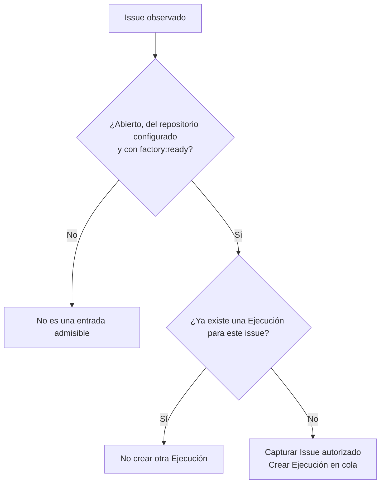
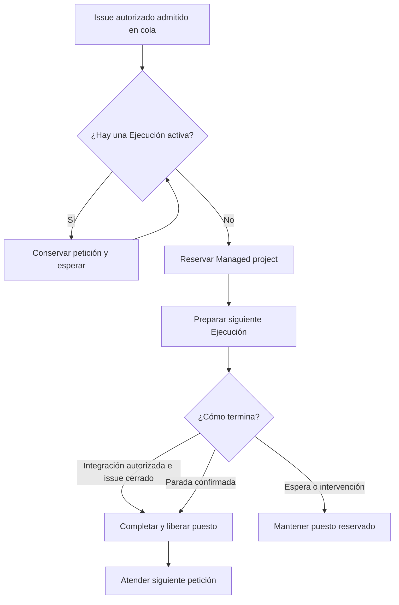
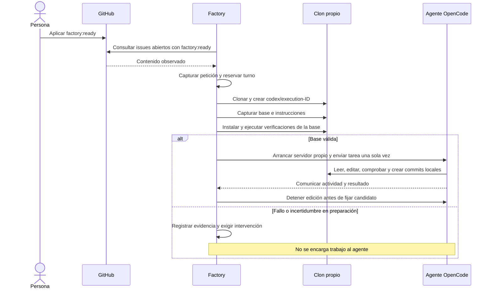

# 2. Del issue al trabajo del agente

[Índice](README.md) · [Anterior](01-mapa.md) · [Siguiente: verificación y aceptación](03-verificacion-y-aceptacion.md)

## Antes del primer issue

La persona que opera la Factory prepara una configuración de confianza: repositorio del Managed project, rama base, instrucciones, instalación, verificaciones, identidad del proyecto Vercel para las previews. La configuración permanece fuera del clon que modifica el agente.

También prepara los accesos de GitHub, Vercel y OpenCode, el marcador de versión del producto y la protección de la rama. El marcador, normalmente `/version.json`, declara el SHA completo del build. Un build marcado como sucio (`dirty: true`) no sirve como evidencia.

La protección se configura mediante una operación administrativa explícita. Exige PR, rama actualizada, conversaciones resueltas y los controles `Factory / ready-to-merge` y `Vercel`, conservando las protecciones existentes. La consulta periódica de la Factory no configura esa protección.

Los pasos técnicos están en el [README](../../README.md) y la [guía de Vercel](../guides/vercel-setup.md).

## Preparar y autorizar la petición

Conviene explicar el objetivo y el resultado esperado en lenguaje natural. Encabezados, listas, contexto y límites son opcionales. La persona no necesita preparar pruebas técnicas, selectores ni JSON: la Factory decide las comprobaciones anteriores al merge. La admisión acepta también contenido vacío o incompleto; el agente decide si falta información relevante y pide una aclaración antes de implementar.

Basta con que el issue esté abierto en el repositorio del Managed project y tenga `factory:ready`. La Factory confía en la gestión de etiquetas de GitHub: no comprueba quién la aplicó, sus permisos, si es un bot ni cuándo se editó el contenido. Las PR no son una entrada alternativa.

La Factory obtiene los issues mediante una consulta paginada de abiertos con `factory:ready` y captura el contenido devuelto. No consulta eventos, permisos ni ediciones para admitirlos.

La suficiencia del contenido corresponde al agente, fuera del proceso determinista de admisión. Si pide información o un permiso, el Dashboard muestra la solicitud pendiente. Hoy la Factory no publica esa pregunta en el issue ni devuelve comentarios humanos a la conversación del agente.

## Qué queda fijado

El Issue autorizado conserva título, cuerpo, autor, momento de captura, configuración del Managed project y selección del agente. La captura sirve como encargo inicial y bitácora. Editar el título o el cuerpo después no actualiza el encargo ni bloquea la Ejecución, su aceptación o su cierre. Los registros históricos con datos antiguos de autorización siguen siendo legibles, pero esos datos ya no condicionan la admisión ni la cola.

Cada issue se consume una sola vez dentro del historial persistido. Retirar y volver a aplicar la etiqueta después de admitirlo no crea otra Ejecución. Reabrirlo tampoco es un mecanismo de reintento. Retirar la etiqueta no cancela el trabajo ya admitido.

## Cola y puesto de trabajo

Solo hay una Ejecución activa. El puesto sigue ocupado durante las esperas de revisión, merge y cierre del issue, y también durante una intervención.

La prioridad sigue el momento de primera observación. En una misma consulta, el número de issue y la identidad de la Ejecución desempatan de forma estable.

La cola sobrevive a un reinicio. Dos procesos no pueden usar a la vez la misma raíz de datos ni el mismo Managed project.

## Preparación e Intento

Comprobar primero la base permite distinguir un problema anterior de una regresión introducida por el Commit candidato. Si la base falla, la Factory conserva la causa y el puesto; no encarga al agente arreglarla automáticamente.

El agente recibe la petición fijada, las instrucciones de la base y los comandos permitidos. Puede cambiar el producto y crear commits locales. La Factory conserva el control del push, la PR, los informes y los estados remotos. No entrega al agente las credenciales de publicación.

Si el agente pide un permiso o hace una pregunta, la Ejecución queda esperando y conserva el puesto. El Dashboard muestra la solicitud. La Factory no publica automáticamente la intervención en el issue ni envía las respuestas humanas a la misma sesión. El enlace para registrar una intervención en GitHub es manual; añadir un comentario no reanuda al agente. Hoy se inspecciona y se detiene si hace falta. La continuación mediante comentarios queda para otro cambio. Un error de autenticación, modelo o proceso exige intervención; no hay cambio automático de proveedor ni reenvío de la tarea.
