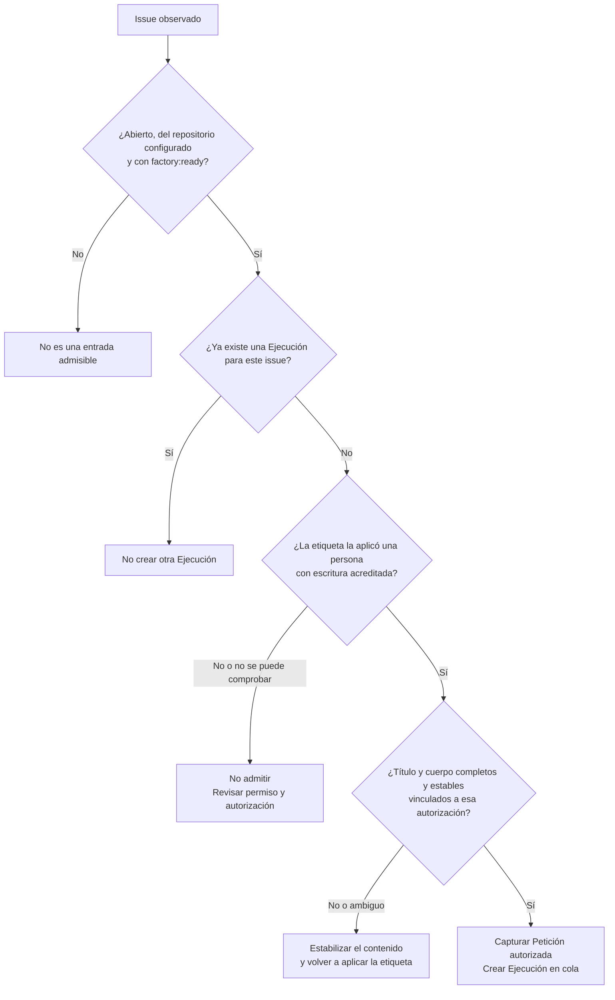
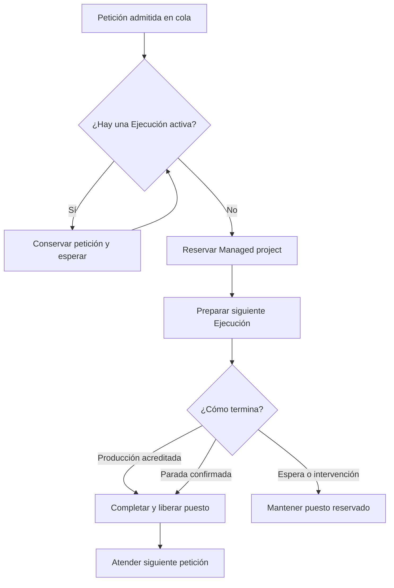
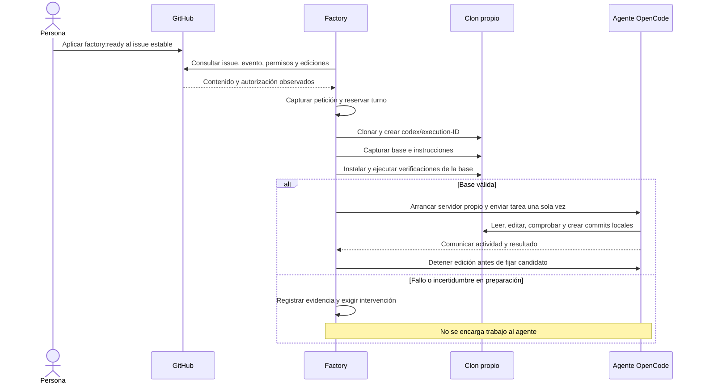

# 2. Del issue al trabajo del agente

[Índice](README.md) · [Anterior](01-mapa.md) · [Siguiente: verificación y aceptación](03-verificacion-y-aceptacion.md)

## Antes del primer issue

La persona que opera la Factory prepara una configuración de confianza: repositorio del Managed project, rama base, instrucciones, instalación, verificaciones, proyecto Vercel y dominio público. La configuración permanece fuera del clon que modifica el agente.

También prepara los accesos de GitHub, Vercel y OpenCode, el marcador de versión del producto y la protección de la rama. El marcador, normalmente `/version.json`, declara el SHA completo del build. Un build marcado como sucio (`dirty: true`) no sirve como evidencia.

La protección se configura mediante una operación administrativa explícita. Exige PR, rama actualizada, conversaciones resueltas y los controles `Factory / ready-to-merge` y `Vercel`, conservando las protecciones existentes. La consulta periódica de la Factory no configura esa protección.

Los pasos técnicos están en el [README](../../README.md) y la [guía de Vercel](../guides/vercel-setup.md).

## Preparar y autorizar la petición

El issue debe explicar el objetivo y los criterios de aceptación. Para completar el ciclo actual debe incluir además un plan `factory-production`, separado de los criterios, que permita comprobarlos en el sitio público. El [ejemplo completo](06-guia-de-un-issue.md) muestra el formato.

La persona revisa el contenido estable y aplica `factory:ready`. Debe tener permiso efectivo de escritura; ser quien creó el issue no basta. La autorización queda ligada al evento de la etiqueta y al contenido observado.

La Factory consulta eventos, permisos, ediciones y una segunda lectura del issue. Una edición simultánea o posterior puede impedir acreditar la autorización; incluso otra actividad que actualice el issue puede exigir autorizar de nuevo. La comprobación es conservadora y no elimina todas las carreras posibles con GitHub.

**Importante:** la admisión no valida por adelantado toda la suficiencia de los criterios ni el plan de producción. Un issue puede ser admitido y quedar detenido después por un plan ausente o inválido. Conviene prepararlo completo antes de autorizar.

## Qué queda fijado

La Petición autorizada conserva título, cuerpo, autor, evento y persona que autoriza, huella del contenido, configuración del Managed project y selección del agente. La Ejecución trabaja sobre esa captura; editar el issue no actualiza su objetivo automáticamente.

Cada issue se consume una sola vez dentro del historial persistido. Retirar y volver a aplicar la etiqueta después de admitirlo no crea otra Ejecución. Reabrirlo tampoco es un mecanismo de reintento. Retirar la etiqueta no cancela el trabajo ya admitido.

## Cola y puesto de trabajo

Solo hay una Ejecución activa. El puesto sigue ocupado durante las esperas de revisión, merge y producción, y también durante una intervención.

La prioridad sigue el orden en que se observa la autorización. En una misma consulta, fecha de autorización, número de issue e identidad desempatan de forma estable. No es una cola ordenada solo por antigüedad de creación del issue.

La cola sobrevive a un reinicio. Dos procesos no pueden usar a la vez la misma raíz de datos ni el mismo Managed project.

## Preparación e Intento

Comprobar primero la base permite distinguir un problema anterior de una regresión introducida por el candidato. Si la base falla, la Factory conserva la causa y el puesto; no encarga al agente arreglarla automáticamente.

El agente recibe la petición fijada, las instrucciones de la base y los comandos permitidos. Puede cambiar el producto y crear commits locales. La Factory conserva el control del push, la PR, los informes y los estados remotos. No entrega al agente las credenciales de publicación.

Si el agente pide un permiso o hace una pregunta, la Ejecución queda esperando. El panel muestra la solicitud, pero todavía no permite responder o continuar de forma guiada. Hoy se inspecciona y se detiene si hace falta. Un error de autenticación, modelo o proceso exige intervención; no hay cambio automático de proveedor ni reenvío de la tarea.
