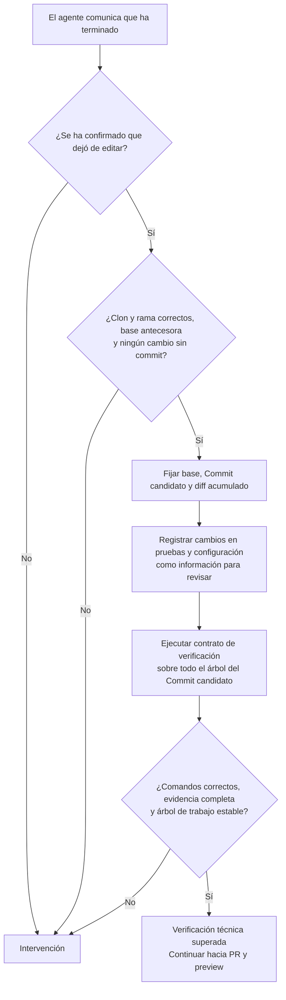
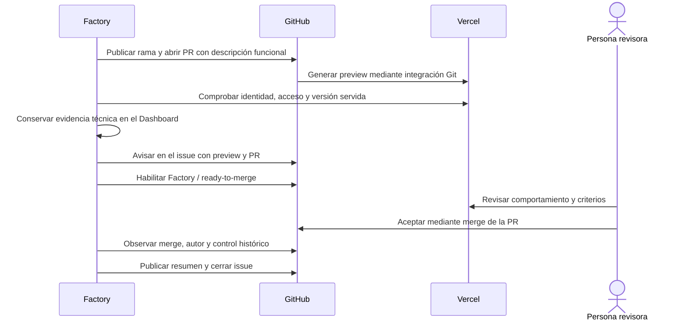

# 3. Del Commit candidato a la aceptación

[Índice](README.md) · [Anterior](02-issue-y-trabajo.md) · [Siguiente: integración y cierre](04-integracion-y-cierre.md)

## Verificar el árbol del Commit candidato

El mensaje «he terminado» del agente inicia la verificación independiente. La Factory detiene primero su edición y fija el SHA del Commit candidato. Revisa todos los cambios entre la base y ese commit, aunque el trabajo incluya varios commits.

En Rebobina, el contrato incluye build, lint, comprobación de tipos, pruebas unitarias y pruebas de navegador. Un comando fallido detiene la secuencia; los posteriores quedan sin ejecutar. No hay un bucle automático para pedir al agente que corrija y vuelva a probar. La persona puede publicar `Corregir: instrucciones` en el issue para iniciar otro Intento y repetir la verificación completa, o `Reintentar` para volver a ejecutar la fase tras corregir la causa. El aviso identifica el comando y su código de salida y dirige a la salida completa del Dashboard. Reintentar la verificación no encarga al agente que cambie el código; para ello se utiliza `Corregir: instrucciones`.

La Factory compara con la base los archivos de comandos, configuración, manifests, lockfiles, scripts y pruebas. Las observaciones aparecen en el Dashboard como información para revisar; no impiden ejecutar los comandos ni publicar un candidato que supere el contrato. El agente puede mantener las pruebas existentes, actualizar expectativas, cambiar dependencias y ajustar la configuración del producto. Por ejemplo, cambiar el mensaje del pie y la expectativa de su test es parte del mismo encargo y no necesita una autorización adicional. La configuración de confianza de la Factory sigue fuera del clon y no puede cambiarla el agente.

Las pruebas de navegador usan un servidor propio para el build del Commit candidato. Un puerto ocupado falla; no se reutiliza otro servidor. Hace falta informe válido y pruebas ejecutadas, sin fallos, omisiones ni resultados inestables. Un código de salida cero, por sí solo, no acredita la comprobación.

**Resultado de negocio:** superar el contrato aporta evidencia técnica. Cada criterio sigue pendiente de juicio humano; una suite verde no demuestra por sí sola que se pidió lo correcto o que la experiencia sea adecuada.

## Publicar PR y comprobar preview

La Factory publica la rama y abre una PR con el título y la descripción funcional redactados por el agente, que referencia el issue sin cerrarlo automáticamente. La descripción está disponible desde la apertura, antes de acreditar la preview. La integración Git de Vercel genera la preview. La Factory comprueba repositorio, proyecto, entorno, SHA desplegado y marcador de versión servido. Abrir un enlace no basta: debe corresponder al Commit candidato verificado.

El acceso protegido se comprueba con las credenciales configuradas, conservando Deployment Protection. Un 401, 403 o redirección deja el acceso sin acreditar. `pending` e `inactive` significan espera; `failure` y `error` requieren intervención. Un error de consulta no demuestra que haya fallado la build.

## Aviso en el issue

Cuando la preview está verificada y la evidencia técnica disponible, la Factory publica un comentario breve en el issue con la URL de preview, el enlace a la PR y estas instrucciones: revisar la preview y hacer merge de la PR para aceptar; responder en el issue con un mensaje sin prefijos para hablar con el agente o pedir cambios. Explica que `Cancelar` detiene la Ejecución y que `Reintentar` recupera una incidencia, ambos como mensaje completo. El aviso no muestra el SHA.

El issue recibe `factory:pending-review`. Antes de que la preview esté acreditada conserva `factory:in-progress`: esa espera es automática, no una revisión humana.

Cada nueva entrega revisable tiene un aviso identificado. La Factory consulta si ya existe antes de repetir un comentario cuya respuesta se perdió. Los reintentos u observaciones repetidas no duplican el aviso. Una nueva entrega o preview puede generar otro aviso; no se editan avisos antiguos. La PR y el Commit candidato vigente identifican la entrega que se puede integrar.

Un fallo al publicar el aviso utiliza la intervención y conciliación existentes. No vuelve a ejecutar desarrollo ni despliegue para repetir un comentario.

## Qué debe revisar una persona

La PR tiene un título que nombra la característica y tres secciones en castellano, con enfoque funcional para personas no técnicas:

- **Resumen:** problema o necesidad, quién lo sufre, enlace al Issue autorizado, comportamiento nuevo y alcance incluido y excluido. Integra los cambios de API, esquema, configuración, variables de entorno, migraciones o flags y cualquier paso de despliegue o activación. Añade diseño, un flujo breve o una alternativa descartada solo cuando ayuden a entender el cambio.
- **Evidencia:** resultados reales seleccionados y pasos para reproducir los casos feliz, vacío y de error cuando existan. Los cambios visibles describen el antes y el después observados con salidas reales. Se identifican la prueba del caso nuevo y su resultado; los pasos manuales quedan como checklist pendiente. Una captura no sustituye haber ejercido el flujo. El agente distingue resultados obtenidos, fallos y comprobaciones pendientes.
- **Riesgo de fusión:** reversibilidad, datos o estado que no se deshacen solos, dependencias y orden de despliegue cuando corresponda. El MVP no incluye radio de impacto.

Estas piezas se integran en el texto; no requieren un encabezado individual. La calidad y suficiencia de la descripción son responsabilidad del agente, que pide intervención cuando necesita una decisión humana. La Factory no valida secciones ni añade bloqueos editoriales. La descripción contiene evidencia seleccionada, no el diff entero ni todos los logs. El runtime no conserva capturas o vídeos E2E ni añade infraestructura de medios para esta entrega.

La Factory deja de publicar el informe técnico como comentario de la PR y no genera fragmentos adicionales. El Dashboard local conserva base, Commit candidato, diff completo, configuración, comandos, códigos, salidas saneadas, cambios informativos de controles, criterios y limitaciones. Las salidas se consultan bajo demanda y corresponden a la verificación vigente; no se añade un archivo histórico completo por versión ni un enlace remoto compartible. La persona valora también si las pruebas modificadas siguen comprobando el comportamiento solicitado.

Para aceptar los cambios, **revisa la preview y haz merge de la PR en GitHub** cuando estén favorables `Factory / ready-to-merge` y los demás controles requeridos. No hace falta escribir un comentario de aceptación, copiar un SHA ni usar una fórmula especial. El merge de una persona con permiso efectivo de escritura registra la Aceptación del resultado para ese Commit candidato.

`Factory / ready-to-merge: success` acredita preparación técnica: verificaciones completas y preview válida de la versión vigente, con la evidencia técnica local disponible. No acredita que la persona haya revisado el resultado. La Ejecución permanece en `awaiting_review` hasta el merge; no hay una espera de aceptación seguida de otra espera de merge.

## Árbol de decisión de los comentarios

Las aclaraciones ya entregadas al agente no se reinterpretan como instrucciones de revisión. Los comentarios propios o de bots se excluyen. Durante `factory:pending-review`, cualquier comentario humano nuevo con contenido en el **issue** llega íntegro al agente: peticiones, preguntas, agradecimientos y fórmulas de aceptación. Solo el merge acepta el resultado; escribir «Acepto» inicia otro Intento, igual que cualquier otro mensaje libre.

Para pedir cambios durante la revisión, escribe directamente lo que necesitas en el issue. Se abre otro Intento en la misma conversación y rama y se exigen nuevas verificaciones, preview y revisión antes de otro merge. `Corregir: ...` también llega como texto al agente; la Factory no interpreta ese prefijo durante la revisión. El agente reescribe el título y la descripción para el cambio acumulado desde la base, no solo para el último commit. Estos mensajes no comprueban permisos del autor. Los comentarios enviados antes de entrar en revisión, durante el trabajo o durante la espera de preview no se ejecutan después como nuevas instrucciones.

Solo `Cancelar` y `Reintentar` completos son comandos: se eliminan los espacios exteriores y no se distinguen mayúsculas. `Cancelar` detiene el trabajo antes de integrar; `Reintentar` recupera una fase fallida según el aviso de intervención. «Cancelar el botón rojo» y «Reintenta» llegan al agente como texto. Fuera de revisión, las correcciones siguen requiriendo `Corregir: instrucciones`. En los comentarios del **PR** se conserva la política anterior: las consultas son informativas y fórmulas como «Corrige el pie», «Cancela» o «Revoco» retiran el control favorable si proceden de una persona con escritura. Cada ID se consume una vez. Editar un comentario procesado no lo convierte en una nueva orden.

## Si algo cambia antes de integrar

- Un nuevo SHA invalida las comprobaciones, la preview y el registro de revisión vigentes. La Factory obtiene ese head en el mismo clon y verifica de nuevo. Cada nueva entrega del agente sustituye el título y la descripción completos, incluidas las ediciones humanas anteriores.
- Una preview sin acreditar retira el control favorable y vuelve a `awaiting_preview`.
- Editar el título o la descripción de la PR no altera el estado de la Ejecución ni sus verificaciones. No se compara el texto con una copia ni se comprueba su igualdad mediante hashes. La edición se conserva hasta la siguiente entrega.
- Una corrección o cancelación retira el control favorable y sigue la recuperación correspondiente.
- Una PR cerrada sin merge requiere intervención. Cerrar el issue tampoco acepta ni detiene el trabajo.

Editar el título o cuerpo del issue no actualiza el encargo capturado. El issue admitido no vuelve a entrar al retirar y volver a poner la etiqueta de autorización.

La Factory observa por consultas periódicas. La retirada del control no es instantánea y un fallo de red puede impedir confirmarla. El Dashboard conserva esa incertidumbre. Deben mantenerse las protecciones de rama y el merge humano. La Factory no acredita qué preview abrió realmente la persona; registra el autor, la fecha y la versión del merge.
