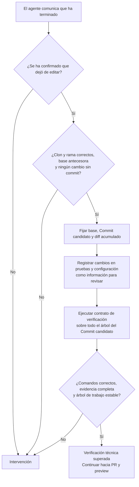
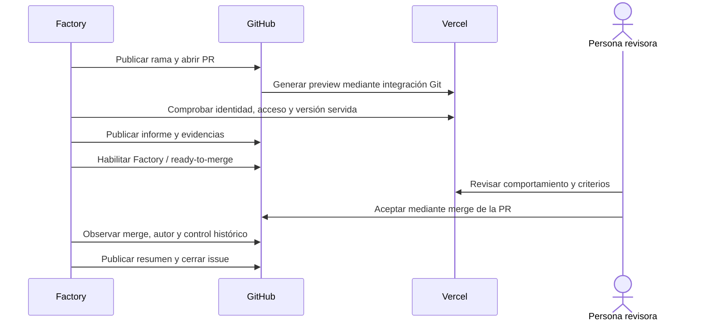

# 3. Del Commit candidato a la aceptación

[Índice](README.md) · [Anterior](02-issue-y-trabajo.md) · [Siguiente: integración y cierre](04-integracion-y-cierre.md)

## Verificar el árbol del Commit candidato

El mensaje «he terminado» del agente inicia la verificación independiente. La Factory detiene primero su edición y fija el SHA del Commit candidato. Revisa todos los cambios entre la base y ese commit, aunque el trabajo incluya varios commits.

En Rebobina, el contrato incluye build, lint, comprobación de tipos, pruebas unitarias y pruebas de navegador. Un comando fallido detiene la secuencia; los posteriores quedan sin ejecutar. No hay un bucle automático para pedir al agente que corrija y vuelva a probar. La persona puede publicar `Corregir: instrucciones` en el issue para iniciar otro Intento y repetir la verificación completa, o `Reintentar` para volver a ejecutar la fase tras corregir la causa. El aviso identifica el comando y su código de salida y dirige a la salida completa del Dashboard. Reintentar la verificación no encarga al agente que cambie el código; para ello se utiliza `Corregir: instrucciones`.

La Factory compara con la base los archivos de comandos, configuración, manifests, lockfiles, scripts y pruebas. Las observaciones aparecen en el Dashboard y en el informe de la PR como información para revisar; no impiden ejecutar los comandos ni publicar un candidato que supere el contrato. El agente puede mantener las pruebas existentes, actualizar expectativas, cambiar dependencias y ajustar la configuración del producto. Por ejemplo, cambiar el mensaje del pie y la expectativa de su test es parte del mismo encargo y no necesita una autorización adicional. La configuración de confianza de la Factory sigue fuera del clon y no puede cambiarla el agente.

Las pruebas de navegador usan un servidor propio para el build del Commit candidato. Un puerto ocupado falla; no se reutiliza otro servidor. Hace falta informe válido y pruebas ejecutadas, sin fallos, omisiones ni resultados inestables. Un código de salida cero, por sí solo, no acredita la comprobación.

**Resultado de negocio:** superar el contrato aporta evidencia técnica. Cada criterio sigue pendiente de juicio humano; una suite verde no demuestra por sí sola que se pidió lo correcto o que la experiencia sea adecuada.

## Publicar PR y comprobar preview

La Factory publica la rama y abre una PR que referencia el issue sin cerrarlo automáticamente. La integración Git de Vercel genera la preview. La Factory comprueba repositorio, proyecto, entorno, SHA desplegado y marcador de versión servido. Abrir un enlace no basta: debe corresponder al Commit candidato verificado.

El acceso protegido se comprueba con las credenciales configuradas, conservando Deployment Protection. Un 401, 403 o redirección deja el acceso sin acreditar. `pending` e `inactive` significan espera; `failure` y `error` requieren intervención. Un error de consulta no demuestra que haya fallado la build.

## Qué debe revisar una persona

El informe de la PR reúne el Issue autorizado, la Ejecución, la base, el Commit candidato, el diff acumulado, las verificaciones, los cambios informativos en controles del producto, las evidencias por criterio, las lagunas y la preview. Si no cabe en un comentario, se divide en fragmentos enlazados sin truncar evidencia. La persona valora también si las pruebas modificadas siguen comprobando el comportamiento solicitado.

Para aceptar los cambios, **revisa la preview y haz merge de la PR en GitHub** cuando estén favorables `Factory / ready-to-merge` y los demás controles requeridos. No hace falta escribir un comentario de aceptación, copiar un SHA ni usar una fórmula especial. El merge de una persona con permiso efectivo de escritura registra la Aceptación del resultado para ese Commit candidato.

`Factory / ready-to-merge: success` acredita preparación técnica: verificaciones completas, preview válida e informe íntegro de la versión vigente. No acredita que la persona haya revisado el resultado. La Ejecución permanece en `awaiting_review` hasta el merge; no hay una espera de aceptación seguida de otra espera de merge.

## Árbol de decisión de los comentarios

Las aclaraciones ya entregadas al agente no se reinterpretan como instrucciones de revisión. Los comentarios propios o de bots se excluyen. Los demás comentarios ordinarios, incluidas fórmulas anteriores de aceptación, son informativos: solo el merge acepta el resultado.

Para pedir cambios, publica `Corregir: instrucciones` en el **issue**. Abre otro Intento en la misma conversación y rama y exige nuevas verificaciones, preview e informe antes de otro merge. `Cancelar` detiene el trabajo antes de integrar. Estas órdenes operativas no comprueban permisos del autor. `Reintentar` recupera una fase fallida según el aviso de intervención.

Las fórmulas anteriores de bloqueo, como «Corrige el pie», «Cancela» o «Revoco», siguen retirando el control favorable si proceden de una persona con escritura. No sustituyen las órdenes operativas completas. Cada ID se consume una vez. Editar un comentario procesado no lo convierte en una nueva orden.

## Si algo cambia antes de integrar

- Un nuevo SHA invalida las comprobaciones, la preview y el informe vigentes. La Factory obtiene ese head en el mismo clon, verifica de nuevo y publica la nueva entrega para revisión.
- Una preview sin acreditar retira el control favorable y vuelve a `awaiting_preview`.
- Un informe o fragmento editado o eliminado exige republicar evidencia íntegra antes de volver a habilitar merge.
- Una corrección o cancelación retira el control favorable y sigue la recuperación correspondiente.
- Una PR cerrada sin merge requiere intervención. Cerrar el issue tampoco acepta ni detiene el trabajo.

Editar el título o cuerpo del issue no actualiza el encargo capturado. El issue admitido no vuelve a entrar al retirar y volver a poner la etiqueta de autorización.

La Factory observa por consultas periódicas. La retirada del control no es instantánea y un fallo de red puede impedir confirmarla. El Dashboard conserva esa incertidumbre. Deben mantenerse las protecciones de rama y el merge humano. La Factory no acredita qué preview abrió realmente la persona; registra el autor, la fecha y la versión del merge.
