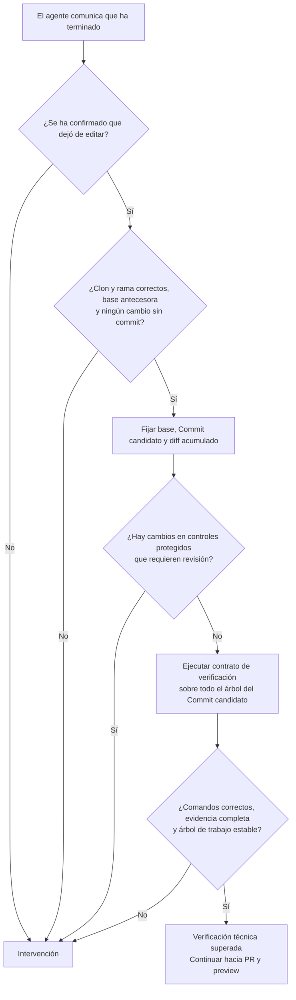
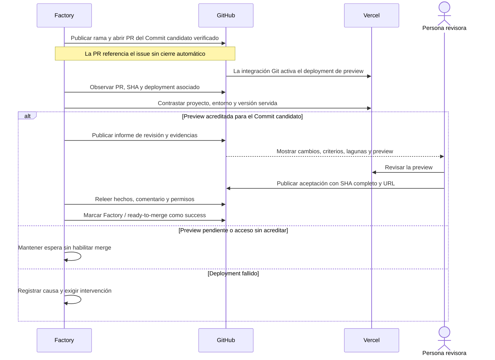
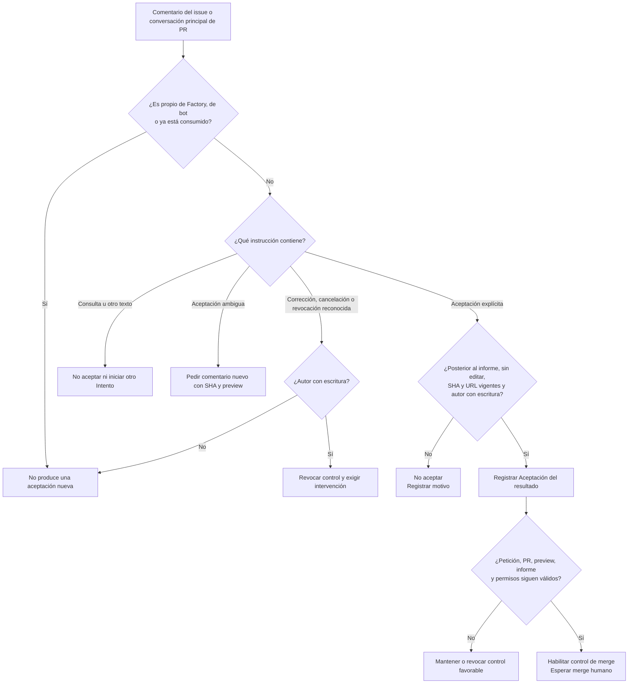
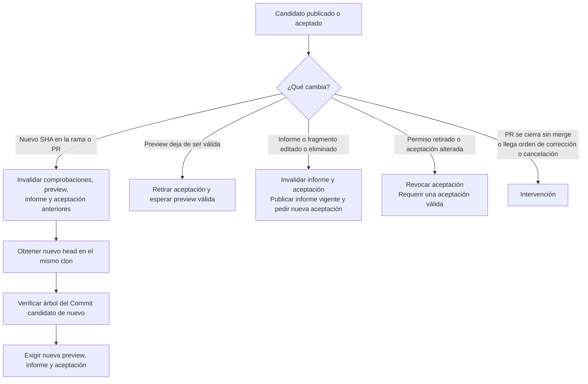

# 3. Del Commit candidato a la aceptación

[Índice](README.md) · [Anterior](02-issue-y-trabajo.md) · [Siguiente: integración y cierre](04-integracion-y-cierre.md)

## Verificar el árbol del Commit candidato

El mensaje «he terminado» del agente inicia la verificación independiente. La Factory detiene primero su edición y fija el SHA del Commit candidato. Revisa todos los cambios entre la base y ese commit, aunque el trabajo incluya varios commits.



En Rebobina, el contrato incluye build, lint, comprobación de tipos, pruebas unitarias y pruebas de navegador. Un comando fallido detiene la secuencia; los posteriores quedan sin ejecutar. No hay un bucle automático para pedir al agente que corrija y vuelva a probar.

La Factory compara controles con la base: comandos, configuración, manifests, lockfiles y pruebas existentes. Eliminar o modificar controles, omitir pruebas o hacer que solo se ejecuten algunas requiere intervención. Añadir pruebas sin esas señales sí está permitido. La revisión es conservadora: puede señalar cambios inocuos y no detecta todo debilitamiento posible.

Las pruebas de navegador usan un servidor propio para el build del Commit candidato. Un puerto ocupado falla; no se reutiliza otro servidor. Hace falta informe válido y pruebas ejecutadas, sin fallos, omisiones ni resultados inestables. Un código de salida cero, por sí solo, no acredita la comprobación.

**Resultado de negocio:** superar el contrato aporta evidencia técnica. Cada criterio sigue pendiente de juicio humano; una suite verde no demuestra por sí sola que se pidió lo correcto o que la experiencia sea adecuada.

## Publicar PR y comprobar preview



La preview debe coincidir con el Commit candidato, el repositorio, el proyecto Vercel y el entorno configurado. Además, debe estar desplegada correctamente y servir el SHA de ese commit en su marcador. Un enlace que abre, pero apunta a otra versión o proyecto, no cumple.

La Factory usa acceso autenticado a Vercel cuando corresponde y conserva Deployment Protection. Un 401, 403 o redirección deja el acceso sin acreditar. `pending` e `inactive` significan espera; `failure` y `error` del deployment exigen intervención. Un error al consultar el proveedor significa falta de observación, no prueba que la build haya fallado.

## Qué debe revisar una persona

El informe de la PR reúne el Issue autorizado, la Ejecución, la base, el Commit candidato, el diff acumulado, las verificaciones, la evidencia por criterio, las lagunas y la preview. Si no cabe en un comentario, se divide en fragmentos enlazados; no se recorta el diff para aparentar evidencia completa.

La persona revisa el comportamiento en preview y decide si satisface los criterios. Para aceptar, publica un comentario nuevo en el issue o en la conversación principal de la PR, usando el ejemplo exacto del informe:

```text
Acepto la versión SHA_COMPLETO y su preview URL_DE_LA_PREVIEW.
```

`SHA_COMPLETO` se sustituye por los 40 caracteres del Commit candidato. La URL debe coincidir con la del informe. Se puede usar también la frase equivalente en inglés que reconoce el sistema. Una review de GitHub con «Approve», un comentario inline o un mensaje genérico no sustituyen este comentario de aceptación.

## Árbol de decisión de los comentarios



La interpretación reconoce fórmulas concretas; no interpreta cualquier frase libre como una orden. «¿Puedo aceptar?» es una consulta. «Acepto» exige aclaración. Para revocar puede usarse, por ejemplo, un comentario nuevo que empiece por `Revoco` o `Cancela`.

Cada ID de comentario se consume una sola vez. Corregir un comentario editándolo no lo convierte en una aceptación válida; hay que publicar otro. La aceptación tampoco sirve si es anterior al informe, señala otra preview, usa una versión antigua o procede de una persona sin escritura acreditada.

## Si algo cambia antes de integrar



Un nuevo SHA provoca reverificación automática del Commit candidato publicado; no crea otro Intento del agente. Editar el título o el cuerpo del issue no actualiza el encargo capturado ni invalida la aceptación. El issue ya consumido no vuelve a entrar por quitar y poner la etiqueta.

La Factory observa por consultas periódicas. La revocación no es instantánea y un fallo de red puede impedir confirmar su escritura en GitHub. El dashboard conserva esa incertidumbre. El control favorable debe combinarse con las protecciones de la rama y el merge humano.
