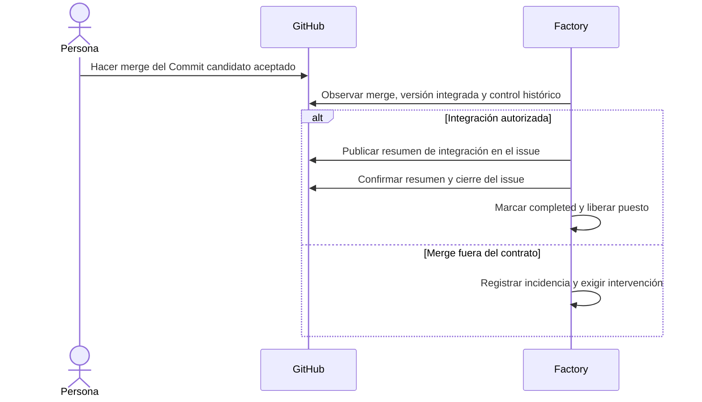

# 4. Del merge al cierre

[Índice](README.md) · [Anterior](03-verificacion-y-aceptacion.md) · [Siguiente: variantes e intervención](05-variantes-e-intervencion.md)

## El merge lo hace una persona

`Factory / ready-to-merge: success` indica que la Factory acredita una aceptación vigente para el Commit candidato. La persona integra en GitHub respetando los demás controles del repositorio. El creador del issue se responsabiliza de conseguir la revisión del preview; cualquier persona con permiso efectivo de escritura puede aceptar la versión concreta.

La Factory observa el merge y conserva por separado base, Commit candidato aceptado y commit integrado. Un squash puede generar otro SHA. Comprueba la rama destino, los permisos, el informe y la aceptación anteriores al merge y el control favorable vigente al integrar. Un merge fuera de este contrato queda en intervención, aunque el issue ya esté cerrado.

La observación puede coincidir con el merge. El historial del informe, la aceptación y el control de GitHub permite reconstruir qué estaba aceptado al integrar. Una preview retirada después del merge no necesita seguir activa.

## Secuencia hasta completar

Durante el cierre, `closing_issue` conserva el puesto. El resumen identifica la Ejecución, la base, el candidato, la preview aceptada, quién aceptó, el commit integrado, la PR y quién hizo el merge. La Factory confirma el resumen antes de cerrar el issue.

## Qué significa «completado»

La Ejecución termina como `completed` cuando la integración autorizada, el resumen y el cierre del issue quedan confirmados. Entonces se libera el puesto y puede empezar la siguiente petición.

Si el issue ya estaba cerrado después del merge, se publica el mismo resumen y se reconoce el cierre existente. Cerrar el issue manualmente no sustituye la aceptación de preview ni autoriza un merge fuera del contrato.

Si se pierde la respuesta al publicar el resumen o cerrar el issue, la Ejecución conserva el puesto y muestra el error. La siguiente consulta busca el efecto remoto antes de repetirlo para evitar duplicados. Si cambia la petición o falta el resumen requerido, no completa. Un reinicio sigue exigiendo recuperación autorizada.

## Límite del MVP

La revisión funcional se realiza en la preview de Vercel antes de aceptar. El MVP no espera ni verifica producción después del merge, no abre un navegador público y no exige un plan técnico en el issue ni lo genera como artefacto interno. Vercel puede desplegar la rama base mediante su integración Git; ese proceso queda fuera de la Ejecución de la Factory.
