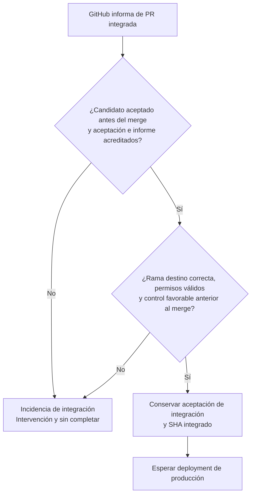
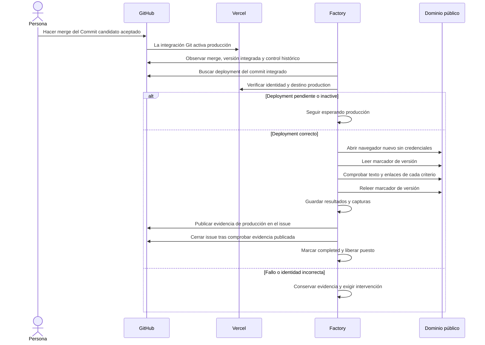
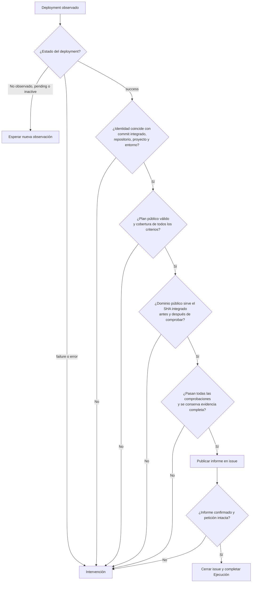

# 4. Del merge al cierre

[Índice](README.md) · [Anterior](03-verificacion-y-aceptacion.md) · [Siguiente: variantes e intervención](05-variantes-e-intervencion.md)

## El merge lo hace una persona

`Factory / ready-to-merge: success` indica que la Factory acredita una aceptación vigente para el Commit candidato. No ejecuta el merge. La persona integra en GitHub respetando los demás controles del repositorio.

La Factory observa el merge y conserva por separado base, Commit candidato aceptado y commit integrado. Un squash puede generar otro SHA; producción debe corresponder al integrado.

Se comprueba también que no haya instrucciones de revocación autorizadas anteriores al merge. Un merge externo sin estas garantías es una incidencia, aunque GitHub lo permita o el issue ya esté cerrado.

La observación puede coincidir con el merge. La Factory usa el historial del informe, la aceptación y el control de GitHub para reconstruir qué estaba aceptado al integrar; no exige que una preview retirada después del merge siga activa para siempre.

## Secuencia hasta completar

La Factory acredita el deployment GitHub del commit integrado, repositorio y entorno configurados. Después contrasta con Vercel el proyecto y `target: production`. No basta con encontrar cualquier deployment verde o una marca genérica de entorno de producción.

## Qué se comprueba en el sitio público

La navegación usa una sesión nueva, online y sin credenciales. Solo admite lecturas GET/HEAD al origen de producción configurado. Una preview accesible mediante credenciales no sustituye esta comprobación pública.

El plan `factory-production` declara entre 1 y 30 comprobaciones. Cada una vincula un criterio numerado desde 1 con una ruta local del sitio, un selector y texto exacto o un enlace interno. `follow: true` exige además navegar por el enlace. Debe haber al menos una comprobación por criterio.

Para una comprobación de texto, el elemento debe ser único y visible; se normalizan espacios al comparar. Para un enlace se comprueba el `href` declarado y, si se pide seguirlo, que la navegación al destino responda correctamente. Las rutas del plan no admiten URLs externas ni parámetros de consulta.

El marcador se lee antes y después para detectar que el dominio haya cambiado de versión durante la revisión. Se rechaza una versión diferente, un build sucio, una redirección o un acceso que no sea público.

Las comprobaciones actuales cubren contenido visible y navegación interna declarados. Una interacción que requiera enviar formularios, autenticar usuarios o validar un comportamiento que el plan no expresa necesita ampliar la verificación antes de acreditar producción. Añadir una comprobación superficial no demuestra ese criterio.

## Qué significa «completado»

La Ejecución termina como `completed` cuando la producción pedida queda acreditada, la evidencia se conserva y el informe está publicado en el issue antes del cierre. Entonces se libera el puesto.

Un cierre manual del issue no prueba producción ni cancela por sí solo la Ejecución. La Factory mantiene la obligación de verificar; si el issue ya estaba cerrado, solo puede completar después de reunir las mismas evidencias.

Si producción falla, se conserva la evidencia obtenida y la Ejecución queda en intervención. No hay rollback, promoción alternativa ni reparación automática. Después del merge, una intervención de producción no se resuelve repitiendo comprobaciones en cada consulta.
