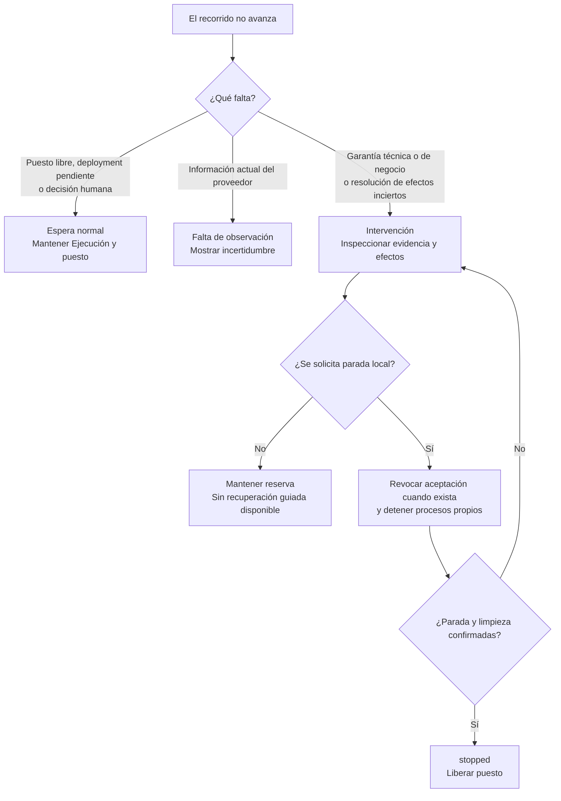
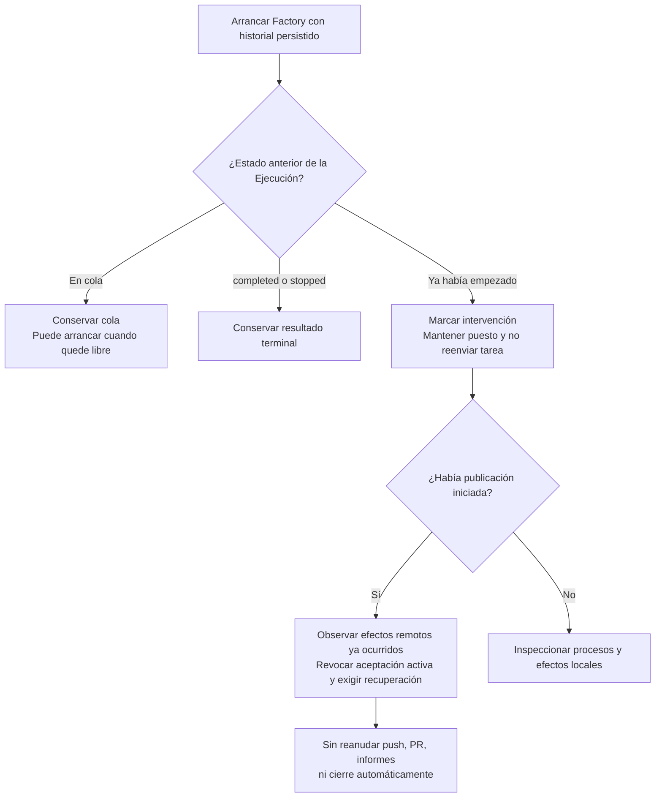

# 5. Variantes e intervención

[Índice](README.md) · [Anterior](04-integracion-y-cierre.md) · [Siguiente: guía de un issue](06-guia-de-un-issue.md)

## Elegir el tipo de respuesta



`intervention` no significa que todos los componentes dejen de observar. Antes del merge, algunas consultas de publicación siguen conciliando hechos y pueden recuperar una condición transitoria. Eso no autoriza a repetir el trabajo del agente o la preparación.

## Variantes antes de publicar

| Situación                                                                             | Comportamiento actual                                                       | Qué necesita la persona                                                                   |
| ------------------------------------------------------------------------------------- | --------------------------------------------------------------------------- | ----------------------------------------------------------------------------------------- |
| Issue sin etiqueta, cerrado o de otro repositorio                                     | No entra como petición admisible.                                           | Prepararlo en el Managed project y autorizarlo.                                           |
| Etiqueta aplicada sin escritura acreditada, contenido cambiado o autorización ambigua | No se admite; no bloquea otras peticiones válidas de la misma consulta.     | Revisar acceso, estabilizar contenido y volver a autorizar.                               |
| Issue ya admitido, reabierto o etiquetado otra vez                                    | No se crea otra Ejecución en ese historial.                                 | Revisar la Ejecución existente; no usar la etiqueta como botón de reintento.              |
| Hay una Ejecución activa                                                              | Las nuevas peticiones válidas permanecen en cola.                           | Resolver o detener de forma confirmada la activa.                                         |
| Fallan clonación, instalación o comprobaciones de base                                | Intervención de preparación; no empieza el agente.                          | Corregir la causa y revisar los efectos ya realizados. No hay recuperación guiada actual. |
| El agente pide permiso o formula una pregunta                                         | `waiting`, con solicitud visible y puesto ocupado.                          | Inspeccionar y detener si procede. El dashboard no permite responder.                     |
| Falla el agente, la autenticación o su proceso                                        | Intervención, sin reenvío ni cambio automático de modelo.                   | Revisar el error y el estado del proceso.                                                 |
| Quedan cambios sin commit o no se confirma la parada del agente                       | No se fija un Commit candidato acreditado.                                  | Resolver la incertidumbre; no aceptar el resultado como verificado.                       |
| Cambian controles protegidos o fallan comandos                                        | Intervención; se conserva la causa y los comandos posteriores sin ejecutar. | Revisar el Commit candidato. No se encarga una corrección automática.                     |
| Evidencia truncada, informe E2E ausente, cero pruebas u omisiones                     | No se aprueba técnicamente aunque el comando devuelva cero.                 | Obtener evidencia suficiente mediante una recuperación deliberada.                        |

## Variantes de PR, preview y revisión

| Situación                                                                                 | Resultado y continuación                                                                                                                    |
| ----------------------------------------------------------------------------------------- | ------------------------------------------------------------------------------------------------------------------------------------------- |
| Deployment aún no observado, `pending` o `inactive`                                       | Esperar; no declarar build fallida.                                                                                                         |
| Preview protegida o con acceso sin acreditar                                              | No habilitar aceptación efectiva ni merge; resolver el acceso conservando la protección.                                                    |
| Deployment declara `failure` o `error`                                                    | Intervención. La observación posterior puede detectar nuevos hechos antes del merge; no hay reparación automática de código.                |
| Error al consultar GitHub o Vercel                                                        | Registrar falta de observación. Si había aceptación, intentar retirar el control favorable y mostrar si la revocación no se confirmó.       |
| Push, PR o comentario ocurrió, pero se perdió su confirmación                             | Consultar si el efecto ya existe antes de repetirlo para evitar duplicados. Un reinicio impone además recuperación autorizada.              |
| Cambia el SHA publicado                                                                   | Invalidar evidencia y aceptación anteriores; obtener el nuevo head y repetir verificación, preview e informe.                               |
| Se edita o elimina informe o fragmento                                                    | Retirar aceptación; volver a publicar informe vigente y exigir otra aceptación posterior.                                                   |
| Aceptación temprana, editada, ambigua, antigua o sin permiso                              | No aceptar. Si es ambigua, pedir un comentario nuevo que identifique SHA y preview.                                                         |
| Comentario propio, de bot o ya consumido                                                  | No genera una aceptación nueva. Una cuenta compartida no acredita separación técnica entre persona y Factory.                               |
| Una persona hace una consulta                                                             | No acepta ni inicia otro Intento.                                                                                                           |
| Se retira el permiso de quien aceptó o se altera su comentario                            | Revocar la aceptación vigente al observarlo; hace falta otra aceptación válida.                                                             |
| Una persona con escritura da una orden reconocida de corrección, revocación o cancelación | Retirar aceptación y bloquear el avance en intervención. No aplicar automáticamente la corrección ni dar por detenidos todos los procesos.  |
| Cambia título o cuerpo de la petición                                                     | Bloquear el avance y pedir revisión y nueva autorización. La captura anterior no cambia. El issue consumido no se readmite automáticamente. |
| Se cierra la PR sin merge                                                                 | Intervención; no completar ni asumir que se publicó.                                                                                        |
| Se retira `factory:ready` después de la admisión                                          | El trabajo ya admitido no se cancela.                                                                                                       |

Una ampliación de alcance requiere una nueva petición revisada. Con la admisión actual puede necesitar un issue nuevo, una vez resuelta o detenida la Ejecución anterior; no existe un comando para reemplazar su captura.

Cerrar manualmente el issue antes del merge impide mantener una aceptación efectiva para integrar y puede dejar la publicación en intervención. No equivale a detener la Ejecución ni libera su puesto. El caso de cierre manual después del merge se trata a continuación.

## Variantes después de integrar

| Situación                                                                                  | Resultado                                                                                                                              |
| ------------------------------------------------------------------------------------------ | -------------------------------------------------------------------------------------------------------------------------------------- |
| Merge sin aceptación vigente, sin control favorable o por identidad sin permiso acreditado | Incidencia de integración; no acreditar el ciclo como correcto.                                                                        |
| Squash con SHA diferente del Commit candidato                                              | Variante válida: conservar ambas versiones en el resumen de integración.                                                               |
| Merge mientras la Factory estaba consultando o intentando revocar                          | Contrastar aceptación, informe y control históricos anteriores al merge. No asumir que el orden de observación local es el orden real. |
| Error o incertidumbre operativa después del merge                                          | Conservar hechos y error. Conciliar el resumen y el cierre antes de repetir efectos.                                                   |
| Issue cerrado manualmente                                                                  | Publicar el resumen y confirmar la integración autorizada; reconocer el cierre existente.                                              |
| Fallo al publicar informe o cerrar issue                                                   | No marcar `completed` sin confirmar lo necesario. Conservar efectos para inspección, sin repetirlos a ciegas.                          |

## Parar no deshace lo ocurrido

La parada operativa se solicita desde la CLI, identificando la Ejecución:

```sh
npm start -- stop --config factory.local.json --id ID_DE_EJECUCION
```

La Factory intenta revocar la aceptación, interrumpir la sesión y detener el grupo de procesos propio. Durante verificación también espera el cierre del comando y comprueba la limpieza del servidor de pruebas.

Solo libera el puesto si confirma la parada necesaria. Si hay procesos o efectos inciertos, o la limpieza de la verificación requiere una terminación forzada, mantiene intervención y reserva. Un fallo de revocación remota puede impedir completar la parada normal de publicación; hay que inspeccionar el estado real.

Una parada confirmada no borra commits, elimina PR, revierte un merge ni retira producción. Un comentario `Cancela` en GitHub revoca y bloquea, pero no equivale a ejecutar la parada operativa de la CLI.

## Reinicio y pérdida de evidencia



La Factory registra intención antes de los efectos y confirmación después. Esta separación permite reconocer una PR creada aunque se haya perdido la respuesta. No garantiza una transacción única entre GitHub, Vercel y el almacenamiento local.

Si falla la persistencia, bloquea nuevos efectos propios. La persona debe inspeccionar los procesos registrados y detenerlos manualmente si no se puede guardar la parada. El fallo de escritura no garantiza que un proceso ya lanzado se haya detenido.

## Cómo interpretar el dashboard

| Señal                                 | Significado                                                             |
| ------------------------------------- | ----------------------------------------------------------------------- |
| `queued`                              | Issue autorizado capturado, esperando puesto.                           |
| `preparing` / `starting` / `running`  | Preparación, arranque o trabajo del agente.                             |
| `waiting`                             | Pregunta o permiso pendiente del agente.                                |
| `awaiting_verification` / `verifying` | Resultado recibido, pendiente de comprobar o en comprobación.           |
| `awaiting_preview`                    | Candidato verificado; publicación o preview todavía sin acreditar.      |
| `awaiting_review`                     | Informe disponible; falta aceptación válida.                            |
| `awaiting_merge`                      | Aceptación acreditada y control favorable; falta merge humano.          |
| `closing_issue`                       | Merge autorizado observado; falta confirmar resumen y cierre.           |
| `intervention`                        | Fallo, garantía ausente o efectos inciertos; revisar la causa concreta. |
| `stopped` / `completed`               | Parada confirmada / recorrido completo acreditado.                      |

La Factory consulta GitHub al arrancar y programa la siguiente consulta 15 segundos después de terminar. El dashboard consulta cada 2 segundos después de completar la lectura anterior. Ninguno solapa sus propias consultas.

El dashboard distingue conexión local, observación de OpenCode y actividad del agente. Los avisos tras 30 segundos sin conexión o 2 minutos sin actividad automática no reenvían tareas. Una espera humana no se trata como inactividad automática del agente.

Los tokens y costes mostrados son observaciones o estimaciones de OpenCode. Un coste cero o no disponible no demuestra gratuidad; no es gasto facturado ni una condición de aceptación del cambio.

## Capacidades que todavía no existen

No hay continuación guiada de preguntas, reintento automático de Intentos, reparación automática tras verificaciones fallidas, recuperación operativa completa, rollback automático ni merge automático. El modo manual `run` sin Managed project es una herramienta de preparación de lectura; en el workflow de issues se rechaza y nunca sustituye a la autorización de GitHub.
