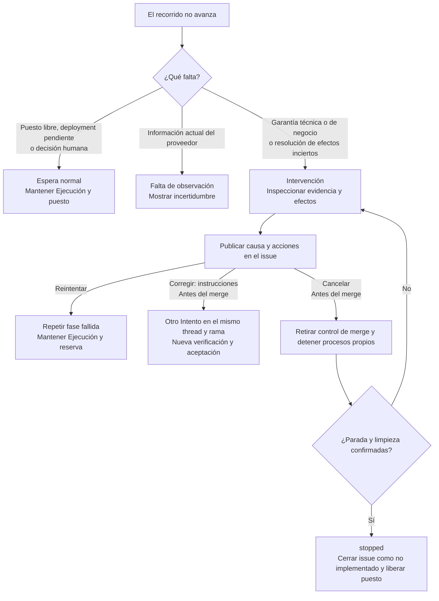
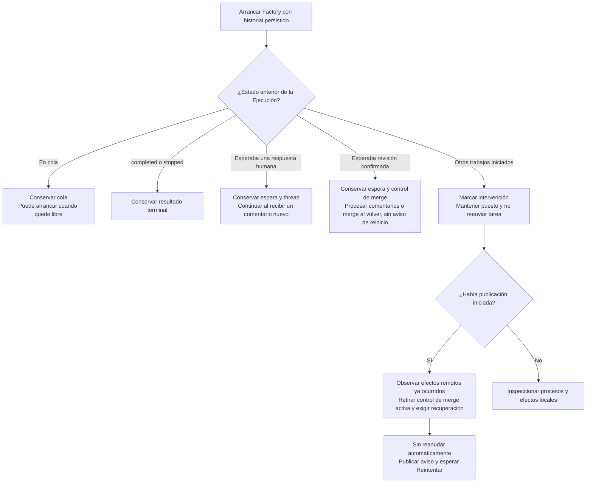

# 5. Variantes e intervención

[Índice](README.md) · [Anterior](04-integracion-y-cierre.md) · [Siguiente: guía de un issue](06-guia-de-un-issue.md)

## Elegir el tipo de respuesta



`intervention` no significa que todos los componentes dejen de observar. Antes del merge, algunas consultas de publicación siguen conciliando hechos y pueden recuperar una condición transitoria. Eso no autoriza a repetir el trabajo del agente o la preparación.

## Recuperar desde el issue

La Factory publica un comentario por incidencia con la causa, la fase, el trabajo conservado y las acciones disponibles. La persona responde con una orden completa en un comentario nuevo del **issue**, no de la PR. No se comprueban permisos del autor; se excluyen bots y comentarios propios de la Factory. Durante una incidencia, las consultas y los comentarios ordinarios no activan operaciones. En `factory:pending-review`, cualquier mensaje nuevo con contenido se envía al agente sin prefijos, salvo los comandos completos `Reintentar` y `Cancelar`.

| Orden                     | Comportamiento                                                                                                                                                                                                                                                                                                                                           |
| ------------------------- | -------------------------------------------------------------------------------------------------------------------------------------------------------------------------------------------------------------------------------------------------------------------------------------------------------------------------------------------------------- |
| `Reintentar`              | Repite la fase fallida dentro de la misma Ejecución. En preparación reutiliza el clon existente y repite las comprobaciones de base. En verificación repite el contrato completo. Si el fallo pertenece al agente y ya existe thread, abre otro Intento en ese thread. En publicación continúa el paso pendiente.                                        |
| `Corregir: instrucciones` | Durante intervención o espera de preview, antes del merge y con thread y workspace disponibles, abre otro Intento conservando conversación, rama y PR. En revisión no se interpreta el prefijo: el mensaje completo llega al agente como cualquier otro texto. Retira el control de merge y exige nueva verificación, preview, descripción y aceptación. |
| `Cancelar`                | Antes del merge, confirma la parada y cierra el issue como no implementado (`not_planned`). Si no confirma la parada, mantiene intervención, issue abierto y reserva. No elimina rama ni PR.                                                                                                                                                             |

Cuando falla una verificación, el aviso identifica el Commit candidato, el comando afectado y su código de salida, o indica que ese código no está confirmado. Explica cómo abrir la salida completa en el Dashboard y si quedaron comandos posteriores sin ejecutar. Los procesos con parada o limpieza inciertas requieren inspección local antes de recuperar.

Para elegir la acción:

- Usa `Reintentar` después de resolver un problema de entorno o corregir la causa por otra vía. En verificación ejecuta de nuevo el contrato sobre el código que haya en la rama; no envía una tarea de corrección al agente.
- Usa `Corregir: instrucciones` cuando el agente deba cambiar el código o las pruebas. Por ejemplo: `Corregir: Corrige el fallo de verificación indicado y deja el candidato listo para verificar.`
- Usa `Cancelar` para detener y cerrar el encargo antes del merge.

La Factory no inicia otra corrección por el mero hecho de observar el fallo. Las órdenes mantienen su significado y cada comentario autoriza una acción concreta.

La Factory acusa recibo antes de ejecutar una orden y publica su resultado. Si la recuperación falla, conserva una única orden pendiente con sus instrucciones y mantiene la intervención; observar el candidato anterior no lo vuelve a habilitar para revisión. `Reintentar` retoma esa orden. Si el envío al agente queda sin confirmar, requiere inspección local y no reenvía la tarea a ciegas.

Sin una orden pendiente, `Reintentar` necesita el aviso de intervención vigente. Una orden incompatible o un reintento sin incidencia recibe una explicación. Una orden recibida durante otra recuperación no programa un nuevo Intento; si vuelve a fallar, publica otra orden después del resultado. No se reejecuta un comentario ya consumido. Durante una espera de dudas, una respuesta libre sigue siendo aclaración; `Cancelar` permite cancelar esa espera.

Desde el issue, después del merge solo se permite `Reintentar` para terminar el resumen y el cierre pendientes. No revierte lo integrado ni encarga cambios nuevos. Las incidencias de un merge fuera del contrato siguen requiriendo inspección; reintentar no convierte una integración inválida en aceptada.

Si hay que arreglar credenciales o procesos locales, lo hace el operador antes de reintentar. Una respuesta pendiente de publicar se concilia en la siguiente consulta sin volver a ejecutar la orden aplicada. El MVP conserva una única orden y una única respuesta pendientes por Ejecución.

## Variantes antes de publicar

| Situación                                                           | Comportamiento actual                                                       | Qué necesita la persona                                                                                                                                                     |
| ------------------------------------------------------------------- | --------------------------------------------------------------------------- | --------------------------------------------------------------------------------------------------------------------------------------------------------------------------- |
| Issue sin etiqueta, cerrado o de otro repositorio                   | No entra como petición admisible.                                           | Prepararlo en el Managed project y autorizarlo.                                                                                                                             |
| Issue ya admitido, reabierto o etiquetado otra vez                  | No se crea otra Ejecución en ese historial.                                 | Revisar la Ejecución existente; no usar la etiqueta como botón de reintento.                                                                                                |
| Hay una Ejecución activa                                            | Las nuevas peticiones válidas permanecen en cola.                           | Resolver o detener de forma confirmada la activa.                                                                                                                           |
| Fallan clonación, instalación o comprobaciones de base              | Intervención de preparación; no empieza el agente.                          | Corregir la causa y comentar `Reintentar`; se reutiliza el clon y se repiten las comprobaciones de preparación.                                                             |
| El agente pide información o una confirmación de producto           | `waiting`, con las dudas publicadas en el issue y el puesto ocupado.        | Responder con un comentario nuevo en el issue. El primer comentario humano vuelve al mismo thread sin comprobar permisos del autor.                                         |
| Hay una solicitud técnica de permiso pendiente                      | Se mantienen los controles técnicos existentes.                             | Un comentario de aclaración no concede permisos adicionales.                                                                                                                |
| Falla el agente, la autenticación o su proceso                      | Intervención, sin reenvío ni cambio automático de modelo.                   | Revisar el error, corregir la causa local si procede y comentar `Reintentar` o `Corregir: instrucciones`.                                                                   |
| Quedan cambios sin commit o no se confirma la parada del agente     | No se fija un Commit candidato acreditado.                                  | Resolver la incertidumbre; no aceptar el resultado como verificado.                                                                                                         |
| Cambian pruebas, scripts, dependencias o configuración del producto | Comparación informativa; se ejecuta el contrato completo.                   | Revisar esos cambios en el diff y en el Dashboard antes de aceptar el resultado. No requiere desbloqueo previo.                                                             |
| Falla un comando de verificación                                    | Intervención; se conserva la causa y los comandos posteriores sin ejecutar. | Pedir `Corregir: instrucciones` si el agente debe cambiar código, o `Reintentar` después de resolver la causa. Reintentar verificación no encarga una corrección al agente. |
| Evidencia truncada, informe E2E ausente, cero pruebas u omisiones   | No se aprueba técnicamente aunque el comando devuelva cero.                 | Obtener evidencia suficiente mediante una recuperación deliberada.                                                                                                          |

## Variantes de PR, preview y revisión

| Situación                                                         | Resultado y continuación                                                                                                                                                                                                                                             |
| ----------------------------------------------------------------- | -------------------------------------------------------------------------------------------------------------------------------------------------------------------------------------------------------------------------------------------------------------------- |
| Deployment aún no observado, `pending` o `inactive`               | Esperar; no declarar build fallida.                                                                                                                                                                                                                                  |
| Preview protegida o con acceso sin acreditar                      | No habilitar merge; resolver el acceso conservando la protección.                                                                                                                                                                                                    |
| Deployment declara `failure` o `error`                            | Intervención. La observación posterior puede detectar nuevos hechos antes del merge; no hay reparación automática de código.                                                                                                                                         |
| Error al consultar GitHub o Vercel                                | Registrar falta de observación. Si había control favorable, intentar retirar el control favorable y mostrar si la revocación no se confirmó.                                                                                                                         |
| Push, PR o comentario ocurrió, pero se perdió su confirmación     | Consultar si el efecto ya existe antes de repetirlo para evitar duplicados. Un reinicio impone además recuperación autorizada.                                                                                                                                       |
| Cambia el SHA publicado                                           | Invalidar evidencia y preparación anteriores; obtener el nuevo head y repetir verificación, preview y revisión. La nueva entrega del agente sustituye la descripción completa.                                                                                       |
| Se edita el título o la descripción de la PR                      | Conservar el estado y las verificaciones. No comprobar igualdad editorial; mantener el texto hasta la siguiente entrega del agente.                                                                                                                                  |
| Comentario que expresa aceptación                                 | En el Issue durante revisión llega al agente; en la PR es informativo. Solo el merge humano de la PR acepta el resultado.                                                                                                                                            |
| Comentario propio, de bot o ya consumido                          | No activa instrucciones nuevas. La cuenta compartida no demuestra separación técnica de identidades.                                                                                                                                                                 |
| Una persona hace una consulta                                     | En el Issue durante revisión inicia otro Intento; en la PR no inicia trabajo. No acepta el resultado.                                                                                                                                                                |
| Una persona escribe un mensaje nuevo en el issue durante revisión | Sin comprobar permisos: retirar el control de merge y enviar el texto íntegro al agente. Solo `Reintentar` y `Cancelar` completos son comandos, sin distinguir mayúsculas ni espacios exteriores. Cancelar requiere parada confirmada y cierra como no implementado. |
| Cambia título o cuerpo de la petición                             | No bloquea el avance, la aceptación ni el cierre. El encargo capturado no cambia y el issue no se readmite.                                                                                                                                                          |
| Se cierra la PR sin merge                                         | Intervención; no completar ni asumir que se publicó.                                                                                                                                                                                                                 |
| Se retira `factory:ready` después de la admisión                  | El trabajo ya admitido no se cancela.                                                                                                                                                                                                                                |

Para encargar trabajo independiente, crea otro issue con `factory:ready`. Editar el issue admitido no reemplaza el encargo capturado. Los comentarios ordinarios llegan al agente cuando espera una respuesta a sus dudas o cuando el Issue está en `factory:pending-review`. En revisión, incluso preguntas y agradecimientos inician otro Intento. Un mensaje recibido entre consultas a GitHub retira el control favorable hasta su entrega, sin provocar una intervención por carecer de prefijo. Los mensajes anteriores a la revisión no se convierten retroactivamente en órdenes. `Corregir: instrucciones` sigue siendo una orden explícita durante intervención o espera de preview; en revisión llega íntegramente como cualquier otro mensaje. Cada corrección exige nueva verificación y revisión.

Cerrar manualmente el issue antes del merge impide mantener el control favorable de merge y puede dejar la publicación en intervención. No equivale a detener la Ejecución ni libera su puesto. El caso de cierre manual después del merge se trata a continuación.

## Variantes después de integrar

| Situación                                                                                 | Resultado                                                                                                                                          |
| ----------------------------------------------------------------------------------------- | -------------------------------------------------------------------------------------------------------------------------------------------------- |
| Merge sin evidencia vigente, sin control favorable o por identidad sin permiso acreditado | Incidencia de integración; no acreditar el ciclo como correcto.                                                                                    |
| Squash con SHA diferente del Commit candidato                                             | Variante válida: conservar ambas versiones en el resumen de integración.                                                                           |
| Merge mientras la Factory estaba consultando o intentando revocar                         | Contrastar el registro local de revisión y el control histórico anteriores al merge. No asumir que el orden de observación local es el orden real. |
| Error o incertidumbre operativa después del merge                                         | Conservar hechos y error. Conciliar el resumen y el cierre antes de repetir efectos.                                                               |
| Issue cerrado manualmente                                                                 | Publicar el resumen y confirmar la integración autorizada; reconocer el cierre existente.                                                          |
| Fallo al publicar resumen de integración o cerrar issue                                   | No marcar `completed` sin confirmar lo necesario. Conservar efectos para inspección, sin repetirlos a ciegas.                                      |

## Parar no deshace lo ocurrido

La parada operativa se solicita desde la CLI, identificando la Ejecución:

```sh
npm start -- stop --config factory.local.json --id ID_DE_EJECUCION
```

La Factory intenta retirar el control de merge, interrumpir la sesión y detener el grupo de procesos propio. Durante verificación también espera el cierre del comando y comprueba la limpieza del servidor de pruebas.

Solo libera el puesto si confirma la parada necesaria. Si hay procesos o efectos inciertos, o la limpieza de la verificación requiere una terminación forzada, mantiene intervención y reserva. Un fallo de revocación remota puede impedir completar la parada normal de publicación; hay que inspeccionar el estado real.

Una parada confirmada no borra commits, elimina PR, revierte un merge ni retira producción. La orden completa `Cancelar` en el issue ejecuta la parada y cierra como no implementado antes del merge. La CLI `stop` sigue siendo una parada operativa: por sí sola no cierra el issue. Durante la revisión del Issue, `Cancela` llega al agente como texto; usa únicamente `Cancelar` para cancelar la Ejecución.

## Descartar una Ejecución bloqueante durante las pruebas del MVP

Si una Ejecución problemática impide continuar las pruebas, puedes descartarla administrativamente mediante un comando local. Sirve en cualquier fase pendiente, incluso después del merge cuando se atascan el resumen o el cierre. Conserva el historial y libera el único puesto sin intentar completar ni reanudar ese trabajo.

1. En el Dashboard, abre **Configuración, procesos y evidencia**. En la modal **Evidencia y detalles de la ejecución**, el primer apartado **Código de la Ejecución** muestra la fila **ID de la ejecución**. Selecciona y copia el ID completo.
2. Para la Factory y espera a que termine su proceso. El comando adquiere los mismos locks de la carpeta de datos y del Managed project; rechaza una instancia activa o una reserva que pertenece a otra Ejecución o carpeta de datos.
3. Ejecuta desde el repositorio de la Factory:

   ```sh
   npm start -- discard --config factory.local.json --id ID_DE_EJECUCION
   ```

4. Si señala un PID o grupo todavía activo, inspecciónalo y detenlo manualmente antes de repetir. El comando comprueba los PID y grupos registrados del agente, su conexión local y los comandos de verificación mediante señal 0. No intenta matarlos ni exige o comprueba un reinicio del ordenador.
5. Arranca la Factory con la configuración habitual. El Dashboard muestra **Descartada · Puesto liberado** y permite consultar las evidencias o eliminar sus datos locales con el borrado existente.

La comprobación se limita a los procesos registrados. Los comandos de preparación no guardan PID: si una parada brusca dejó alguno huérfano, debes detenerlo manualmente. Un PID reutilizado por otro proceso también impide el descarte; inspecciona su identidad antes de actuar. Una conexión local ilegible o inválida, o un permiso que impida comprobar un proceso, se rechaza sin liberar el puesto.

El comando funciona offline, sin arrancar agentes ni recuperar la selección anterior de proveedor/modelo. Guarda `stopped` con razón de descarte y una entrada de historial antes de liberar la reserva. Conserva clon, conversación, artefactos, errores, verificaciones y hechos de integración. Si falla la persistencia, no libera la reserva. Si falla la liberación después de guardar, se puede repetir el comando; el arranque también reconoce el registro terminal y libera su reserva.

El descarte no consulta ni cambia GitHub o Vercel. Conserva el issue, sus etiquetas, la rama, la PR, la preview y los controles de merge, aunque alguno siguiera favorable. No revierte un merge ni completa el resumen o el cierre pendientes. Al arrancar, la Factory omite la sincronización de etiquetas y las respuestas pendientes de esa Ejecución descartada.

Para probar otro issue, basta con arrancar de nuevo la Factory. Para repetir el mismo, retira primero `factory:ready` si todavía estuviera presente, elimina la Ejecución descartada desde el Dashboard y vuelve a añadir la etiqueta cuando quieras admitirlo. Si borras su historial mientras sigue abierto con `factory:ready`, la Factory puede admitirlo automáticamente.

## Reinicio y pérdida de evidencia

Antes de recuperar el historial, la Factory compara la selección global con cada Ejecución iniciada pendiente. Si cambia proveedor, modelo o `reasoningEffort`, muestra un error por consola y no arranca. Añadir o retirar un esfuerzo explícito también cambia la selección; la ausencia del campo en registros antiguos representa el predeterminado de OpenCode. Incluye esperas humanas, revisión, intervención y reintentos en cola. Arranca con la selección anterior para terminar o cancelar el trabajo y después cambia la configuración. La cola nunca iniciada adopta la selección nueva al comenzar; `completed` y `stopped` no bloquean. Consulta la [guía de proveedores](../guides/llm-providers.md).



Cerrar la Factory mediante Ctrl-C o SIGTERM conserva la Ejecución, el puesto, el trabajo y la conversación. Una revisión confirmada (`awaiting_review`) conserva la PR, la preview, el Intento y el control favorable de merge. Al arrancar continúa esperando en silencio y procesa los comentarios o el merge ocurridos durante la parada con las reglas habituales. No publica un aviso de intervención ni exige `Reintentar` por ese reinicio.

Una espera humana conserva su solicitud. Los demás trabajos iniciados quedan en intervención y requieren `Reintentar` tras arrancar: la Factory interrumpe la verificación en curso y comprueba su limpieza, intenta revocar el control de merge y detiene el servidor del agente. Una parada no confirmada conserva la incertidumbre y la reserva. El comando operativo `stop` sigue terminando la Ejecución y revocando el control de merge. Si no se confirma la entrega de una respuesta al agente, se registra una incidencia y no se reenvía automáticamente.

Las ejecuciones que una versión anterior ya dejó en intervención mantienen su recuperación explícita mediante `Reintentar`; este cambio no migra el historial.

La Factory registra intención antes de los efectos y confirmación después. Esta separación permite reconocer una PR creada aunque se haya perdido la respuesta. No garantiza una transacción única entre GitHub, Vercel y el almacenamiento local.

Si falla la persistencia, bloquea nuevos efectos propios. La persona debe inspeccionar los procesos registrados y detenerlos manualmente si no se puede guardar la parada. El fallo de escritura no garantiza que un proceso ya lanzado se haya detenido.

## Cómo interpretar el dashboard

| Señal                                 | Significado                                                                          |
| ------------------------------------- | ------------------------------------------------------------------------------------ |
| `queued`                              | Issue autorizado capturado, esperando puesto.                                        |
| `preparing` / `starting` / `running`  | Preparación, arranque o trabajo del agente.                                          |
| `waiting`                             | Pregunta o permiso pendiente del agente.                                             |
| `awaiting_verification` / `verifying` | Resultado recibido, pendiente de comprobar o en comprobación.                        |
| `awaiting_preview`                    | Candidato verificado; publicación o preview todavía sin acreditar.                   |
| `awaiting_review`                     | Descripción, evidencia técnica y preview disponibles; falta revisión y merge humano. |
| `closing_issue`                       | Merge autorizado observado; falta confirmar resumen y cierre.                        |
| `intervention`                        | Fallo, garantía ausente o efectos inciertos; revisar la causa concreta.              |
| `stopped` / `completed`               | Parada confirmada o descarte administrativo local / recorrido completo acreditado.   |

La Factory consulta GitHub al arrancar y programa la siguiente consulta 15 segundos después de terminar. El dashboard consulta cada 2 segundos después de completar la lectura anterior. Ninguno solapa sus propias consultas.

El dashboard distingue conexión local, observación de OpenCode y actividad del agente. Los avisos tras 30 segundos sin conexión o 2 minutos sin actividad automática no reenvían tareas. Una espera humana no se trata como inactividad automática del agente.

Los tokens y costes mostrados son observaciones o estimaciones de OpenCode. Un coste cero o no disponible no demuestra gratuidad; no es gasto facturado ni una condición de aceptación del cambio.

## Capacidades que todavía no existen

Hay recuperación explícita por comentarios para el flujo del MVP. No hay reintento automático de Intentos, reparación automática tras verificaciones fallidas, recuperación operativa completa, rollback automático ni merge automático. El modo manual `run` sin Managed project es una herramienta de preparación de lectura; en el workflow de issues se rechaza y nunca sustituye a la autorización de GitHub.
