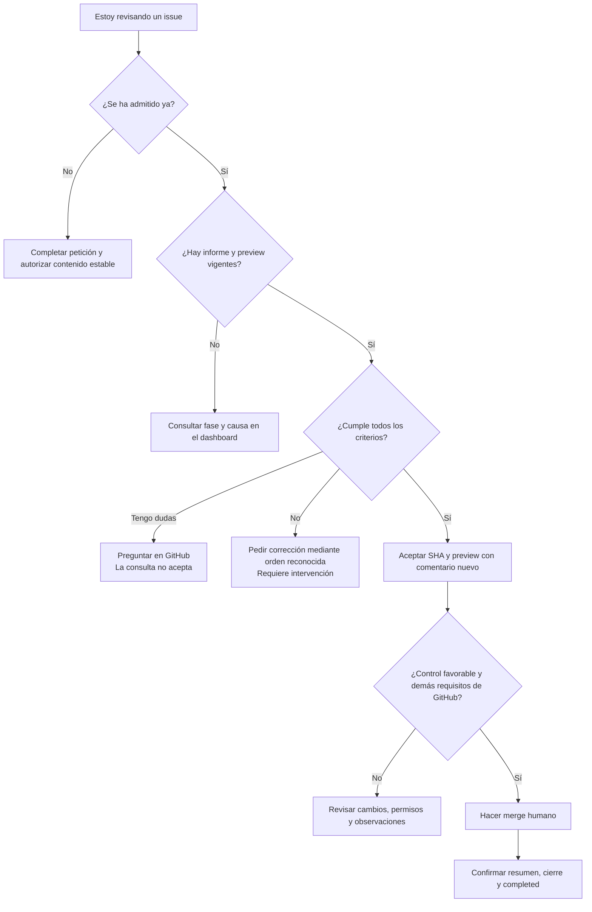

# 6. Guía práctica de un issue completo

[Índice](README.md) · [Anterior](05-variantes-e-intervencion.md)

## Ejemplo: cambiar un pie y comprobar su enlace

El ejemplo es una petición sencilla. No hace falta conocer selectores ni definir pruebas técnicas.

Crear el issue en el repositorio del **Managed project**, con un título como «Actualizar el mensaje del pie y conservar la vuelta al inicio» y este cuerpo:

```text
Quiero mostrar «Otra partida.» en el pie. La página de inicio debe mostrar ese mensaje y el enlace del pie de la página Sobre debe seguir permitiendo volver al inicio.
```

También se pueden usar encabezados de objetivo y criterios, listas o contexto adicional. Son ayudas de escritura, no requisitos del formato. La Factory prepara las comprobaciones técnicas; si falta una decisión de producto, pide una aclaración concreta en lenguaje natural.

## Pasos de la persona responsable

1. **Revisar la petición.** Confirmar que el objetivo y el resultado esperado se entienden.
2. **Autorizar en GitHub.** Una persona con escritura aplica `factory:ready` al contenido estable.
3. **Seguir la Ejecución.** Consultar el Dashboard y cualquier pregunta o intervención. Retirar la etiqueta no cancela un trabajo admitido.
4. **Revisar la PR y su informe.** Leer diff, resultados y lagunas del Commit candidato vigente.
5. **Probar la preview.** El creador del issue se responsabiliza de conseguir la revisión de cada criterio en la URL del informe.
6. **Aceptar o pedir corrección.** Cualquier persona con escritura puede copiar el ejemplo del informe con SHA completo y URL y publicarlo como comentario nuevo. Una orden reconocida de corrección revoca el control y requiere intervención; hoy no lanza otro Intento.
7. **Realizar el merge.** Esperar `Factory / ready-to-merge: success` y los demás controles. Si cambió el candidato, esperar verificación, preview, informe y aceptación nuevos.
8. **Confirmar el final.** Comprobar el resumen de integración, el issue cerrado y el estado `completed`. La Factory no espera ni comprueba producción.

## Decidir durante la revisión



## Cómo reconocer un issue terminado

| Evidencia                                  | Qué demuestra                                                           |
| ------------------------------------------ | ----------------------------------------------------------------------- |
| Issue autorizado                           | Qué se autorizó y quién lo autorizó.                                    |
| Base comprobada                            | Sobre qué versión empezó el trabajo y si ya tenía problemas.            |
| Diff y verificaciones del Commit candidato | Qué cambió y qué controles técnicos superó.                             |
| Preview e informe                          | Qué versión se presentó a revisión y con qué evidencia.                 |
| Comentario de aceptación                   | Qué SHA y preview aceptó una persona con permiso.                       |
| Merge y control histórico                  | Qué candidato se integró, por quién y bajo qué aceptación.              |
| Informe en el issue y `completed`          | Que la Factory conservó la evidencia y completó el recorrido de cierre. |

La revisión humana del preview determina si el resultado cumple los criterios. Las pruebas técnicas aportan evidencia previa al merge; el resumen final acredita la integración y el cierre del issue.
