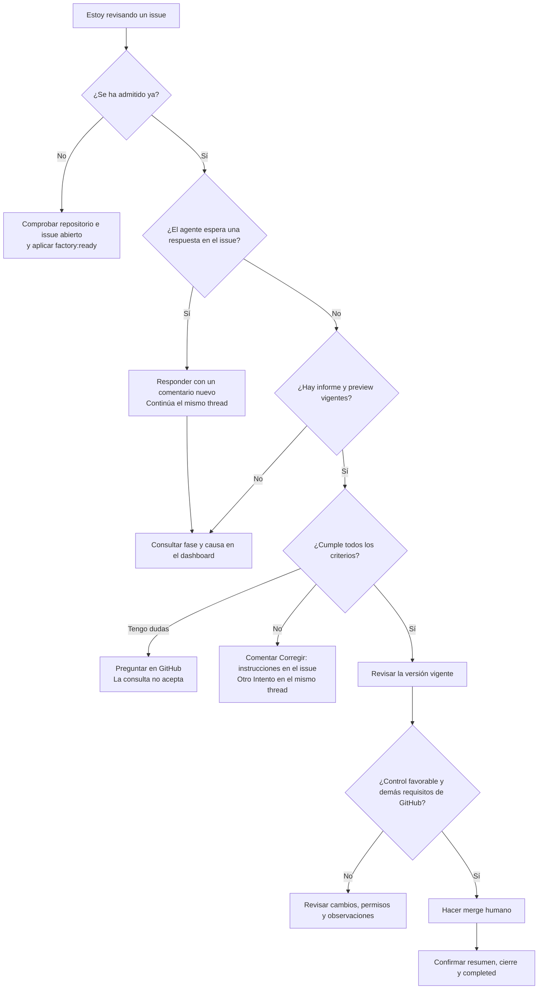

# 6. Guía práctica de un issue completo

[Índice](README.md) · [Anterior](05-variantes-e-intervencion.md)

## Ejemplo: cambiar un pie y comprobar su enlace

El ejemplo es una petición sencilla. No hace falta conocer selectores ni definir pruebas técnicas.

Crear el issue en el repositorio del **Managed project**, con un título como «Actualizar el mensaje del pie y conservar la vuelta al inicio» y este cuerpo:

```text
Quiero mostrar «Otra partida.» en el pie. La página de inicio debe mostrar ese mensaje y el enlace del pie de la página Sobre debe seguir permitiendo volver al inicio.
```

También se pueden usar encabezados de objetivo y criterios, listas o contexto adicional. Son ayudas de escritura, no requisitos del formato. La Factory prepara las comprobaciones técnicas. Si el agente necesita información, la Factory publica sus dudas en el issue y muestra la espera en el Dashboard. El primer comentario humano nuevo posterior a esa solicitud le permite continuar en el mismo thread. Puede reunir varias dudas en cada solicitud y repetir el ciclo cuando lo necesite.

## Pasos de la persona responsable

1. **Revisar la petición.** Confirmar que el objetivo y el resultado esperado se entienden.
2. **Autorizar en GitHub.** Aplicar `factory:ready` al issue abierto. La Factory no acredita al actor ni exige contenido completo.
3. **Seguir la Ejecución y responder dudas.** Consultar el Dashboard y los comentarios del issue. Cuando la Factory publique preguntas del agente, responder con un comentario nuevo; puede contener todas las respuestas. Cualquier persona puede hacerlo. El agente continúa en el mismo thread y puede volver a preguntar. Retirar la etiqueta no cancela un trabajo admitido.
4. **Revisar la PR y su informe.** Leer diff, resultados y lagunas del Commit candidato vigente.
5. **Probar la preview.** El creador del issue se responsabiliza de conseguir la revisión de cada criterio en la URL del informe.
6. **Aceptar o pedir corrección.** Para aceptar, haz merge de la PR cuando `Factory / ready-to-merge` y los demás controles sean favorables. No hace falta un comentario de aceptación. Para corregir, publica `Corregir: instrucciones` en el issue. La Factory conserva thread, rama y PR y abre otro Intento.
7. **Revisar cualquier versión nueva.** Si cambia el candidato, espera nuevas verificaciones, preview e informe y vuelve a revisar antes del merge.
8. **Confirmar el final.** Comprobar el resumen de integración, el issue cerrado y el estado `completed`. La Factory no espera ni comprueba producción.

## Decidir durante la revisión



## Si aparece intervención

Lee el comentario de la Factory y elige una acción disponible. Publica `Reintentar` tras corregir la causa, `Corregir: instrucciones` para encargar una corrección al agente o `Cancelar` para detener y cerrar como no implementado. Basta un comentario humano. Después del merge solo cabe reintentar el resumen y el cierre pendientes.

## Cómo reconocer un issue terminado

| Evidencia                                  | Qué demuestra                                                           |
| ------------------------------------------ | ----------------------------------------------------------------------- |
| Issue autorizado                           | Qué contenido se capturó al observar `factory:ready`.                   |
| Base comprobada                            | Sobre qué versión empezó el trabajo y si ya tenía problemas.            |
| Dudas y respuestas del issue               | Qué información humana recibió el agente durante el trabajo.            |
| Diff y verificaciones del Commit candidato | Qué cambió y qué controles técnicos superó.                             |
| Preview e informe                          | Qué versión se presentó a revisión y con qué evidencia.                 |
| Merge y control histórico                  | Qué candidato se integró, por quién y con qué evidencia técnica previa. |
| Informe en el issue y `completed`          | Que la Factory conservó la evidencia y completó el recorrido de cierre. |

La revisión humana del preview determina si el resultado cumple los criterios. Las pruebas técnicas aportan evidencia previa al merge; el resumen final acredita la integración y el cierre del issue.
