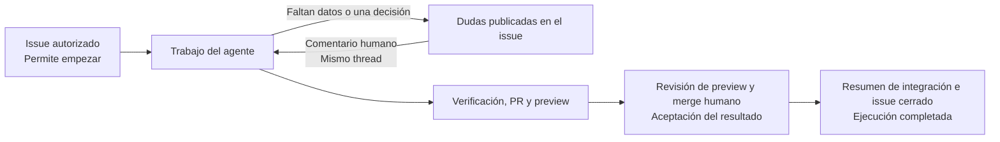

# Manual de negocio de App Foundry

Este manual explica cómo una petición de cambio se convierte en una versión comprobada del producto. Describe el comportamiento implementado en este repositorio.

La **Factory** organiza el trabajo. El **Managed project** es el producto que desarrolla. Una persona autoriza la petición (issue de github), revisa el resultado (preview en Vercel) y realiza el merge (PR en Github). La Factory prepara, encarga el trabajo al agente, comprueba, publica evidencias y completa el cierre tras el merge autorizado.

Si el agente necesita información, la Factory publica sus dudas en el issue. Cualquier persona puede responder con un comentario nuevo para que continúe en el mismo thread. Esta aclaración no sustituye la aceptación posterior del Commit candidato, que se expresa mediante el merge humano de la PR verificada.

Si aparece un fallo, la Factory publica en el issue la causa y las órdenes disponibles: `Reintentar`, `Corregir: instrucciones` y `Cancelar`. Basta un comentario humano, sin comprobar permisos. La corrección conserva conversación, rama y PR; vuelve a pasar por verificación y aceptación. Cancelar cierra como no implementado tras confirmar la parada. Después del merge solo cabe reintentar el resumen y el cierre pendientes.

## Índice y orden de lectura

| Capítulo                                                                   | Qué permite entender                                                   |
| -------------------------------------------------------------------------- | ---------------------------------------------------------------------- |
| [1. Mapa de la fábrica](01-mapa.md)                                        | Responsabilidades, vocabulario y recorrido completo.                   |
| [2. Del issue al trabajo del agente](02-issue-y-trabajo.md)                | Admisión, ejecución y aclaraciones por comentarios en el mismo thread. |
| [3. Del Commit candidato a la aceptación](03-verificacion-y-aceptacion.md) | Verificación, PR, preview, revisión humana y decisiones alternativas.  |
| [4. Del merge al cierre](04-integracion-y-cierre.md)                       | Integración humana, resumen y cierre del issue.                        |
| [5. Variantes e intervención](05-variantes-e-intervencion.md)              | Errores, cambios, cancelación, reinicio y límites actuales.            |
| [6. Guía práctica de un issue completo](06-guia-de-un-issue.md)            | Ejemplo de petición y pasos de la persona responsable.                 |

## Proveedor y modelo

Cada instalación selecciona un proveedor/modelo global y, opcionalmente, un esfuerzo mediante `reasoningEffort` al arrancar. El diagnóstico `test:opencode` lista los esfuerzos disponibles con los valores exactos para configurar el JSON; omitir el campo mantiene el predeterminado de OpenCode. Admite OpenAI con OAuth, Gemini y Claude con API key, y Ollama local experimental, sin catálogo manual de modelos. La [guía de configuración](../guides/llm-providers.md) explica el acceso y sus límites. Cambiar la selección exige terminar o cancelar las Ejecuciones iniciadas pendientes; los issues que nunca empezaron pueden usar la selección nueva.

## La regla principal

Para ponerla en marcha, sigue [la prueba local contra GitHub y Vercel](07-prueba-local-github-vercel.md). Incluye comandos adaptados al equipo y [una descripción de issue lista para copiar](ejemplo-issue-prueba-local.md).

Cada paso responde a una pregunta diferente: «¿queremos este cambio?», «¿funciona técnicamente?», «¿aceptamos esta versión?» y «¿se integró la versión aceptada y quedó cerrado el issue?». Ninguna respuesta sustituye a las demás.

## Alcance y fuentes

| Fuente del repositorio                                                                                                                   | Qué respalda                                                                   |
| ---------------------------------------------------------------------------------------------------------------------------------------- | ------------------------------------------------------------------------------ |
| [GLOSSARY.md](../../GLOSSARY.md)                                                                                                         | Significado de conceptos de negocio.                                           |
| [README operativo](../../README.md)                                                                                                      | Instalación, puesta en marcha, límites y evidencias.                           |
| [Workflow](../../src/application/workflow.ts) y [Factory](../../src/application/factory.ts)                                              | Admisión, cola, preparación, coordinación, parada y reinicio.                  |
| [Admisión GitHub](../../src/infrastructure/github.ts) y [Issue](../../src/domain/request.ts)                                             | Admisión mediante `factory:ready` y captura del contenido.                     |
| [Intervenciones](../../src/application/issueInterventions.ts) y [conversación GitHub](../../src/infrastructure/issueConversation.ts)     | Publicación de dudas y entrega de la primera respuesta humana al mismo thread. |
| [Recuperación por issue](../../src/application/issueRecovery.ts)                                                                         | Avisos de fallos y órdenes explícitas sin comprobación de permisos.            |
| [Verificación](../../src/infrastructure/verification.ts)                                                                                 | Comprobaciones independientes y comparación informativa de controles.          |
| [Publicación](../../src/application/candidatePublication.ts) y [política de revisión](../../src/application/publication/reviewPolicy.ts) | Preview, descripción funcional, evidencia local, aceptación y revocación.      |
| [Integración](../../src/application/publication/integration.ts)                                                                          | Merge autorizado, resumen de integración y cierre.                             |
| [Configuración de Rebobina](../../config/managed-projects/rebobina.json)                                                                 | Ejemplo real de producto, comandos e identidad de preview.                     |
| [Pruebas](../../tests/)                                                                                                                  | Variantes de admisión, verificación, publicación, integración y reinicio.      |
| [Validación de intervenciones](../evidence/issue-interventions/README.md)                                                                | Rondas de aclaraciones, recuperación del thread y alcance de las pruebas.      |
