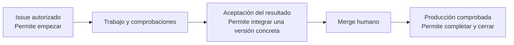

# Manual de negocio de App Foundry

Este manual explica cómo una petición de cambio se convierte en una versión comprobada del producto. Describe el comportamiento implementado en este repositorio a fecha de 18 de octubre de 2026.

La **Factory** organiza el trabajo. El **Managed project** es el producto que desarrolla. Una persona autoriza la petición, revisa el resultado y realiza el merge. La Factory prepara, encarga el trabajo al agente, comprueba, publica evidencias y acredita producción.

## Índice y orden de lectura

| Capítulo                                                                   | Qué permite entender                                                  |
| -------------------------------------------------------------------------- | --------------------------------------------------------------------- |
| [1. Mapa de la fábrica](01-mapa.md)                                        | Responsabilidades, vocabulario y recorrido completo.                  |
| [2. Del issue al trabajo del agente](02-issue-y-trabajo.md)                | Preparación del issue, autorización, admisión, cola y ejecución.      |
| [3. Del Commit candidato a la aceptación](03-verificacion-y-aceptacion.md) | Verificación, PR, preview, revisión humana y decisiones alternativas. |
| [4. Del merge al cierre](04-produccion-y-cierre.md)                        | Integración humana, producción, comprobaciones públicas y cierre.     |
| [5. Variantes e intervención](05-variantes-e-intervencion.md)              | Errores, cambios, cancelación, reinicio y límites actuales.           |
| [6. Guía práctica de un issue completo](06-guia-de-un-issue.md)            | Ejemplo de petición y pasos de la persona responsable.                |

Los gráficos usan Mermaid. GitHub los representa al abrir los archivos Markdown. En otros lectores hace falta soporte Mermaid.

## La regla principal

Para ponerla en marcha, sigue [la prueba local contra GitHub y Vercel](07-prueba-local-github-vercel.md). Incluye comandos adaptados al equipo y [una descripción de issue lista para copiar](ejemplo-issue-prueba-local.md).

Cada paso responde a una pregunta diferente: «¿queremos este cambio?», «¿funciona técnicamente?», «¿aceptamos esta versión?» y «¿está el resultado solicitado en producción?». Ninguna respuesta sustituye a las demás.

## Alcance y fuentes

El manual describe el código local, sus pruebas y la configuración del Managed project. No certifica que las cuentas, permisos, protecciones o deployments remotos estén configurados en este momento. Los diagramas simplifican el recorrido sin añadir recuperación o automatismos que todavía no existen.

| Fuente del repositorio                                                                                                            | Qué respalda                                                                                                                                 |
| --------------------------------------------------------------------------------------------------------------------------------- | -------------------------------------------------------------------------------------------------------------------------------------------- |
| [GLOSSARY.md](../../GLOSSARY.md)                                                                                                  | Significado de Factory, Managed project, Issue de GitHub, Issue autorizado, Commit candidato, Ejecución, Intento y Aceptación del resultado. |
| [README operativo](../../README.md)                                                                                               | Instalación, puesta en marcha, límites y evidencias.                                                                                         |
| [Workflow](../../src/application/workflow.ts) y [Factory](../../src/application/factory.ts)                                       | Admisión, cola, preparación, coordinación, parada y reinicio.                                                                                |
| [Admisión GitHub](../../src/infrastructure/github.ts) y [Issue](../../src/domain/request.ts)                                      | Autorización y captura del contenido.                                                                                                        |
| [Verificación](../../src/infrastructure/verification.ts)                                                                          | Comprobaciones independientes y protección de controles.                                                                                     |
| [Publicación](../../src/application/publication.ts) y [política de revisión](../../src/application/publication/reviewPolicy.ts)   | Preview, informe, aceptación y revocación.                                                                                                   |
| [Producción](../../src/application/publication/production.ts) y [navegador público](../../src/infrastructure/publicProduction.ts) | Merge observado, evidencia pública y cierre.                                                                                                 |
| [Plan de comprobaciones públicas](../../src/domain/production.ts)                                                                 | Formato y cobertura de `factory-production`.                                                                                                 |
| [Configuración de Rebobina](../../config/managed-projects/rebobina.json)                                                          | Ejemplo real de producto, comandos, entornos y dominio.                                                                                      |
| [Pruebas](../../tests/)                                                                                                           | Variantes de admisión, verificación, publicación, producción y reinicio.                                                                     |

**Diferencia documental conocida:** el [ADR 0001](../adr/0001-reuse-opencode-provider-configuration.md) describe reutilizar proveedores y autenticación de OpenCode sin exportar credenciales. El [adaptador actual](../../src/infrastructure/opencode/agent.ts) sigue limitado a OpenAI OAuth y exporta la cuenta activa al servidor propio. Este manual describe ese comportamiento actual; no presenta el alcance del ADR como ya disponible.
