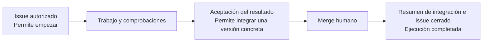

# Manual de negocio de App Foundry

Este manual explica cómo una petición de cambio se convierte en una versión comprobada del producto. Describe el comportamiento implementado en este repositorio a fecha de 18 de octubre de 2026.

La **Factory** organiza el trabajo. El **Managed project** es el producto que desarrolla. Una persona autoriza la petición (issue de github), revisa el resultado (preview en Vercel) y realiza el merge (PR en Github). La Factory prepara, encarga el trabajo al agente, comprueba, publica evidencias y completa el cierre tras el merge autorizado.

## Índice y orden de lectura

| Capítulo                                                                   | Qué permite entender                                                  |
| -------------------------------------------------------------------------- | --------------------------------------------------------------------- |
| [1. Mapa de la fábrica](01-mapa.md)                                        | Responsabilidades, vocabulario y recorrido completo.                  |
| [2. Del issue al trabajo del agente](02-issue-y-trabajo.md)                | Preparación del issue, autorización, admisión, cola y ejecución.      |
| [3. Del Commit candidato a la aceptación](03-verificacion-y-aceptacion.md) | Verificación, PR, preview, revisión humana y decisiones alternativas. |
| [4. Del merge al cierre](04-integracion-y-cierre.md)                       | Integración humana, resumen y cierre del issue.                       |
| [5. Variantes e intervención](05-variantes-e-intervencion.md)              | Errores, cambios, cancelación, reinicio y límites actuales.           |
| [6. Guía práctica de un issue completo](06-guia-de-un-issue.md)            | Ejemplo de petición y pasos de la persona responsable.                |

## La regla principal

Para ponerla en marcha, sigue [la prueba local contra GitHub y Vercel](07-prueba-local-github-vercel.md). Incluye comandos adaptados al equipo y [una descripción de issue lista para copiar](ejemplo-issue-prueba-local.md).

Cada paso responde a una pregunta diferente: «¿queremos este cambio?», «¿funciona técnicamente?», «¿aceptamos esta versión?» y «¿se integró la versión aceptada y quedó cerrado el issue?». Ninguna respuesta sustituye a las demás.

## Alcance y fuentes

| Fuente del repositorio                                                                                                                   | Qué respalda                                                              |
| ---------------------------------------------------------------------------------------------------------------------------------------- | ------------------------------------------------------------------------- |
| [GLOSSARY.md](../../GLOSSARY.md)                                                                                                         | Significado de conceptos de negocio.                                      |
| [README operativo](../../README.md)                                                                                                      | Instalación, puesta en marcha, límites y evidencias.                      |
| [Workflow](../../src/application/workflow.ts) y [Factory](../../src/application/factory.ts)                                              | Admisión, cola, preparación, coordinación, parada y reinicio.             |
| [Admisión GitHub](../../src/infrastructure/github.ts) y [Issue](../../src/domain/request.ts)                                             | Autorización y captura del contenido.                                     |
| [Verificación](../../src/infrastructure/verification.ts)                                                                                 | Comprobaciones independientes y protección de controles.                  |
| [Publicación](../../src/application/candidatePublication.ts) y [política de revisión](../../src/application/publication/reviewPolicy.ts) | Preview, informe, aceptación y revocación.                                |
| [Integración](../../src/application/publication/integration.ts)                                                                          | Merge autorizado, resumen de integración y cierre.                        |
| [Configuración de Rebobina](../../config/managed-projects/rebobina.json)                                                                 | Ejemplo real de producto, comandos e identidad de preview.                |
| [Pruebas](../../tests/)                                                                                                                  | Variantes de admisión, verificación, publicación, integración y reinicio. |
