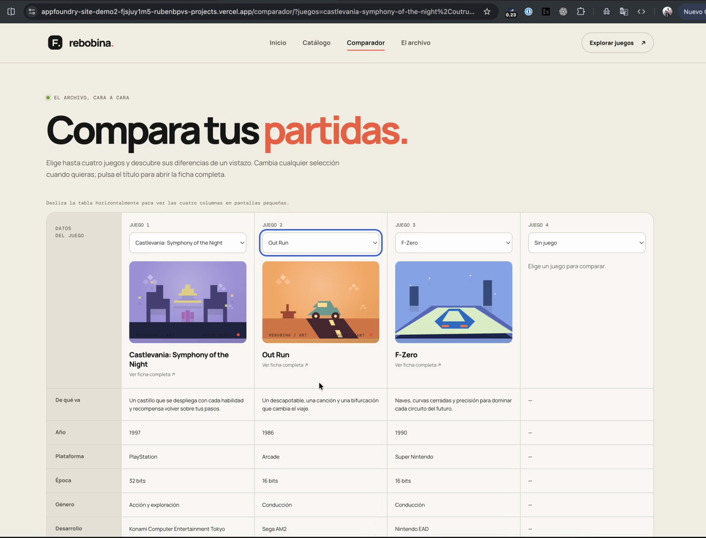
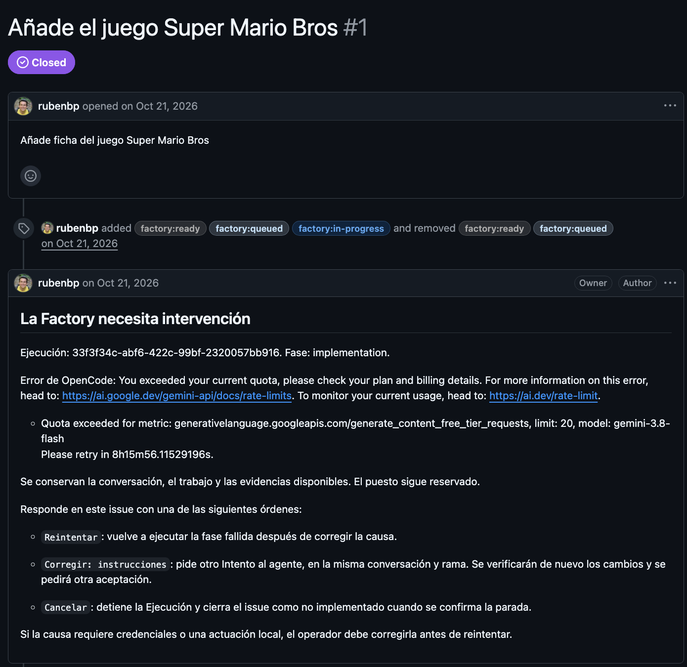

# 4. Verificación y resultados

**En una frase:** 12 de 14 peticiones reales se integraron sin editar código a mano; los fallos vinieron de la Factory mientras la corregía y de las cuotas de los proveedores, y lo que se escapó fue lo que la evaluación del flujo no comprueba.

## 4.1 Cómo lo he verificado

1. **La Factory como software:** 330 pruebas automáticas en 32 archivos, unitarias y de integración con SQLite real, más un test de arquitectura y una prueba real contra OpenCode.
2. **La Factory en uso real:** 14 Ejecuciones sobre Rebobina, con GitHub y Vercel reales, entre el 19 y el 22 de octubre de 2026.

Las Ejecuciones forman dos tandas. En la **tanda 1** (10 Ejecuciones en `appfoundry-site-demo`) corregía la Factory entre una y otra, y muchos de sus errores son defectos que descubrí así. La **tanda 2** (4 Ejecuciones en `appfoundry-site-demo2`) usa un proyecto nuevo preparado con el asistente de configuración y la versión final de la Factory.

## 4.2 Resultados

| Issue                                                                                   | Modelo           | Intentos | Agente (min) | Espera humana (min) | Coste (USD) | Resultado        |
| --------------------------------------------------------------------------------------- | ---------------- | -------- | ------------ | ------------------- | ----------- | ---------------- |
| [demo #8](https://github.com/rubenbp/appfoundry-site-demo/issues/8) Título del pie      | gpt-6-luna       | 1        | 1,7          | 5,5                 | 0,005       | Integrado        |
| [demo #11](https://github.com/rubenbp/appfoundry-site-demo/issues/11) Ficha Suikoden    | gpt-6-sol        | 3        | 4,9          | 46,5                | 0,27        | Integrado        |
| [demo #13](https://github.com/rubenbp/appfoundry-site-demo/issues/13) Ficha Mario       | gpt-6-sol        | 2        | 3,4          | 86,7                | 0,20        | Integrado        |
| [demo #15](https://github.com/rubenbp/appfoundry-site-demo/issues/15) «hola»            | gpt-6-sol        | 2        | 4,2          | 33,8                | 0,29        | Integrado        |
| [demo #16](https://github.com/rubenbp/appfoundry-site-demo/issues/16) Ficha Wipeout     | gpt-6-sol        | 2        | 3,6          | 2,4                 | 0,27        | Integrado        |
| [demo #19](https://github.com/rubenbp/appfoundry-site-demo/issues/19) Comparador        | gpt-6-sol        | 1        | 3,3          | 19,6                | 0,23        | Integrado        |
| [demo #21](https://github.com/rubenbp/appfoundry-site-demo/issues/21) Comparador y URL  | gpt-6-sol        | 1        | 4,3          | 188,1               | 0,20        | Integrado        |
| [demo #23](https://github.com/rubenbp/appfoundry-site-demo/issues/23) Portada rotatoria | gpt-6-luna       | 2        | 2,8          | 6,7                 | 0,01        | Integrado        |
| [demo #25](https://github.com/rubenbp/appfoundry-site-demo/issues/25) Filtro compañía   | gpt-6-luna       | 2        | 5,3          | 26,1                | 0,04        | Cancelado por mí |
| [demo #27](https://github.com/rubenbp/appfoundry-site-demo/issues/27) Mejora del hero   | gpt-6-luna       | 2        | 2,7          | 3,6                 | 0,01        | Integrado        |
| [demo2 #1](https://github.com/rubenbp/appfoundry-site-demo2/issues/1) Ficha Mario       | gemini-3.8-flash | 2        | 18,1         | 0,0                 | 0,25        | Parado por cuota |
| [demo2 #2](https://github.com/rubenbp/appfoundry-site-demo2/issues/2) Ficha Mario       | gpt-6-sol        | 2        | 4,2          | 9,4                 | 0,19        | Integrado        |
| [demo2 #4](https://github.com/rubenbp/appfoundry-site-demo2/issues/4) Comparador        | gpt-6-sol        | 2        | 5,8          | 4,4                 | 0,31        | Integrado        |
| [demo2 #6](https://github.com/rubenbp/appfoundry-site-demo2/issues/6) «Algo nuevo»      | gpt-6-sol        | 1        | 5,1          | 19,2                | 0,26        | Integrado        |

Los tokens y los Intentos son medidos; los minutos se calculan a partir del historial y el coste aplica las tarifas configuradas. La espera humana es tiempo de reloj hasta mi siguiente decisión, así que es un límite superior de mi tiempo activo.

- **Todas las Ejecuciones verificadas superaron las 5 comprobaciones**, y en ninguna edité código.
- **El agente es lo rápido:** con los modelos de OpenAI trabajó entre 1,7 y 5,8 minutos por Ejecución. El tiempo total lo dominan mis esperas y los incidentes.
- **El protocolo de intervención funcionó:** el agente solo preguntó en los dos issues sin requisito concreto, [demo #15](https://github.com/rubenbp/appfoundry-site-demo/issues/15) y [demo2 #6](https://github.com/rubenbp/appfoundry-site-demo2/issues/6).
- **Los 11 Intentos adicionales** se reparten en 3 reintentos por fallos externos, 5 correcciones mías de alcance o de gusto y **3 defectos visuales del agente que las pruebas no detectaron**. Con todo en verde, solo los vi en la preview: la evaluación no cubre el aspecto visual, y ahí el _human in the loop_ es imprescindible.

## 4.3 Dificultades

**Fallos de la Factory.** En [demo #15](https://github.com/rubenbp/appfoundry-site-demo/issues/15) hubo 57 errores de publicación y 3 recuperaciones: un error de red en la API de GitHub, un candidato que cambió antes de autorizar el merge, un reinicio de la Factory y, al final, un merge mío que la Factory no reconoció como autorizado. Ninguno afectó al código: todos estaban en la parte del flujo que coordina con GitHub, y los corregí en la Factory durante la tanda 1.

**Cuotas del proveedor.** En [demo #16](https://github.com/rubenbp/appfoundry-site-demo/issues/16), ChatGPT alcanzó su límite de uso a las 22:13; reintenté a las 06:47 y se integró en minutos, así que casi todos sus 611 minutos son esa noche. En [demo2 #1](https://github.com/rubenbp/appfoundry-site-demo2/issues/1), Gemini agotó la cuota del nivel gratuito (20 peticiones y 250.000 tokens de entrada) sin llegar a un resultado verificable. **Este caso no permite juzgar el modelo.** Repetí el issue con `gpt-6-sol` en [demo2 #2](https://github.com/rubenbp/appfoundry-site-demo2/issues/2) y se completó. En ambos casos, la Factory convirtió el límite en un aviso en el issue y conservó el trabajo.

## 4.4 Qué está probado y qué no

| Estado                     | Contenido                                                                                                                                                                   |
| -------------------------- | --------------------------------------------------------------------------------------------------------------------------------------------------------------------------- |
| **Implementado y probado** | Recorrido completo con GitHub y Vercel reales; correcciones por comentario; aclaraciones en varias rondas; recuperación con `Reintentar` y `Cancelar`; consumo              |
| **Evidencias**             | Issues y PR públicos; historial en SQLite; capturas de este documento; pruebas automáticas; vídeo del [issue #4](https://github.com/rubenbp/appfoundry-site-demo2/issues/4) |
| **Simulado o parcial**     | Claude y Ollama, solo con pruebas sin llamadas reales; Gemini, configurado pero sin Ejecución completa; coste en USD calculado, no facturado                                |
| **No verificado**          | Tiempo humano activo; comparación sin IA en paralelo; proyectos con backend; varias Ejecuciones a la vez                                                                    |
| **Qué limitó las pruebas** | Plazo de 11 días; un único proyecto gestionado, generado con IA y sin backend; cuotas de los proveedores; muestra pequeña, sin valor estadístico                            |
