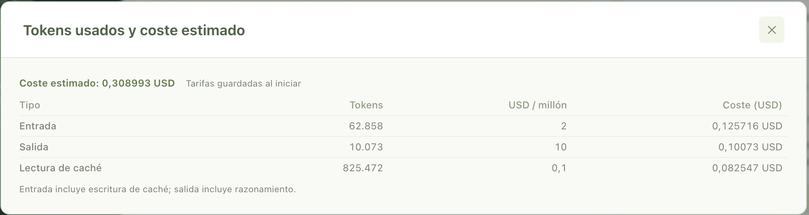

# 5. Justificación de negocio

**En una frase:** con mis supuestos, cada petición cuesta entre 80 y 190 € menos que sin IA y la Factory se amortiza en 7 a 15 peticiones; los tokens son despreciables y el coste real está en operar las incidencias.

## 5.1 Supuestos

Todas las cifras de este apartado son **estimaciones** construidas sobre datos medidos.

- **Perfil sin IA:** un desarrollador frontend con experiencia, a **35 €/h** de coste para la empresa: unos 45.000 € brutos al año, por 1,3 de cargas sociales, entre unas 1.700 horas productivas. Uso el coste interno y no la tarifa de venta, más alta, para que el ahorro quede por lo bajo.
- **Horas sin IA:** incluyen entender la petición, implementar, probar, abrir la PR, esperar la preview y una ronda de corrección.

| Tipo de petición | Issues integrados                                                                                                                                                                                                                                                                                                                                                                                                                                                                       | Horas sin IA por issue |
| ---------------- | --------------------------------------------------------------------------------------------------------------------------------------------------------------------------------------------------------------------------------------------------------------------------------------------------------------------------------------------------------------------------------------------------------------------------------------------------------------------------------------- | ---------------------- |
| Cambio de texto  | [demo #8](https://github.com/rubenbp/appfoundry-site-demo/issues/8)                                                                                                                                                                                                                                                                                                                                                                                                                     | 0,5 – 1                |
| Ficha nueva      | [demo #11](https://github.com/rubenbp/appfoundry-site-demo/issues/11), [#13](https://github.com/rubenbp/appfoundry-site-demo/issues/13) y [#16](https://github.com/rubenbp/appfoundry-site-demo/issues/16); [demo2 #2](https://github.com/rubenbp/appfoundry-site-demo2/issues/2)                                                                                                                                                                                                       | 2 – 3                  |
| Funcionalidad    | [demo #15](https://github.com/rubenbp/appfoundry-site-demo/issues/15), [#19](https://github.com/rubenbp/appfoundry-site-demo/issues/19), [#21](https://github.com/rubenbp/appfoundry-site-demo/issues/21), [#23](https://github.com/rubenbp/appfoundry-site-demo/issues/23) y [#27](https://github.com/rubenbp/appfoundry-site-demo/issues/27); [demo2 #4](https://github.com/rubenbp/appfoundry-site-demo2/issues/4) y [#6](https://github.com/rubenbp/appfoundry-site-demo2/issues/6) | 4 – 8                  |
| **Total**        | **12 issues**                                                                                                                                                                                                                                                                                                                                                                                                                                                                           | **36,5 – 69 h**        |

- **Tiempo humano con la Factory:** de 10 a 20 minutos por petición para escribir el issue, revisar la preview y, si hace falta, corregir. No lo medí; la espera medida en los 12 issues, 7,1 h, es su límite superior.
- **Coste del modelo:** una suscripción de ChatGPT Plus de 23 €/mes, conectada por OAuth. Sin factura por Ejecución, el coste en USD de los tokens es un equivalente calculado con las tarifas configuradas. Imputo la suscripción entera a las Ejecuciones.

## 5.2 Coste de las 12 peticiones

| Concepto                        | Sin IA              | Con la Factory                         | Tipo de dato         |
| ------------------------------- | ------------------- | -------------------------------------- | -------------------- |
| Horas de desarrollo             | 36,5 – 69 h         | 0 h                                    | Estimado / medido    |
| Horas de la persona que decide  | Incluidas arriba    | 2 – 4 h (máximo 7,1 h)                 | Estimado / calculado |
| Coste del modelo                | 0 €                 | 23 € (2,25 USD equivalentes en tokens) | Medido / calculado   |
| **Coste total**                 | **1.278 – 2.415 €** | **95 – 165 € (máximo 274 €)**          | Estimado             |
| **Coste por petición**          | **106 – 201 €**     | **8 – 14 € (máximo 23 €)**             | Estimado             |
| Tiempo hasta la primera preview | Horas o días        | Minutos                                | Estimado / medido    |

El ahorro va de unos **84 €** por petición en el caso más pesimista a unos **193 €** en el más favorable. El [issue #4](https://github.com/rubenbp/appfoundry-site-demo2/issues/4) lo ilustra: un comparador con su corrección, listo en 13,8 minutos por 0,31 USD de tokens.

## 5.3 Coste de construir la Factory

- **Construcción:** unas 33 h entre el 12 y el 22 de octubre. A 35 €/h son 1.155 €, más 23 € de ChatGPT Plus: **unos 1.180 €**. No imputo Cursor, porque la licencia la aporta JAKALA.
- **Punto de equilibrio:** con el ahorro por petición, la Factory se amortiza **entre la petición 7 y la 15**. Las 12 integradas en este TFM ya están en ese rango.
- **Suscripción:** me bastó Plus porque este mes OpenAI restableció el límite de uso cada 2 o 3 días. Con Pro (103 €/mes) serían unos 1.260 € y entre 7 y 16 peticiones.

## 5.4 Lectura honesta

- **La muestra es pequeña:** 14 Ejecuciones en un banco de pruebas sin backend muestran un orden de magnitud, no un ahorro general.
- **El ahorro está en las horas, no en los tokens:** la petición más cara costó 0,31 USD, menos que un minuto de un desarrollador.
- **Operar no es gratis:** las incidencias de la tanda 1 necesitaron a alguien que entendiera la Factory, y no medí ese tiempo. En un proyecto real añadiría una revisión técnica de la PR, de 15 a 30 minutos por petición: reduce el ahorro, pero no lo elimina.
- **Es el coste de un prototipo:** llevar la Factory a producción, con aislamiento real y concurrencia, costaría bastante más.
